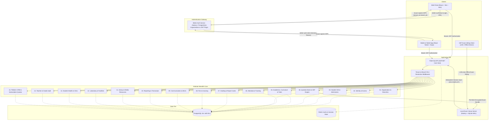

# SOFTWARE REQUIREMENTS SPECIFICATION (SRS)

## Fidel Hub — Enterprise School Management SaaS Platform

| Document Information | Details |
| :--- | :--- |
| **Document ID** | SRS-001 |
| **Version** | 1.1 (Refined & Expanded with Complete Operational Modules) |
| **Product** | Fidel Hub (ፊ) |
| **Market Focus** | K–12 Multi-Tenant Institutions (Ethiopia & East Africa) |
| **Technical Stack** | ASP.NET Core Modular Monolith, PostgreSQL (RLS), Better Auth, React (Vite), React Native (Expo) |
| **Reference Architecture** | PRD-001, TAD-003, DDS-004 & Gila-Schoolmate Functional Architecture |

---

## 1. Introduction & Executive Summary

### 1.1 Purpose
This Software Requirements Specification (SRS) establishes the complete functional and non-functional requirements for **Fidel Hub**, an enterprise-grade multi-tenant School Management SaaS platform. 

The feature specifications in this document incorporate end-to-end institutional workflows—including Student Information Systems (SIS), dual Ethiopian/Gregorian calendars, classroom scheduling, continuous assessment, offline-first Computer-Based Testing (CBT), student fee billing, library circulation, laboratory equipment management, student clinic dispensary, and teacher access auditing. All capabilities are architected to run on Fidel Hub's high-integrity stack: **ASP.NET Core Modular Monolith**, **PostgreSQL with kernel-level Row-Level Security (RLS)**, **Better Auth** authentication service, **React (Vite)** for web administration, and **React Native (Expo)** with offline **SQLite WAL** synchronization for resilient Computer-Based Testing (CBT).

### 1.2 Core Product Scope & Non-Goals

| In-Scope Functional Areas | Explicit Non-Goals (Out of Scope per PRD) |
| :--- | :--- |
| Multi-tenant organizations with independent campuses/branches | Full Double-Entry General Ledger accounting |
| Dual academic calendar (Ethiopian EC & Gregorian GC) | Payroll processing & tax disbursements |
| Student Information System (SIS), Admissions & Guardians | Full enterprise HR & recruitment management |
| Academic Curriculum, Timetables, Lesson Plans & Behavioral Traits | Offline financial payment processing |
| Early Childhood & Nursery/KG Developmental Tracking | Uncontrolled cross-tenant student transfers |
| Daily homeroom and period-by-period attendance | Direct client database connections bypassing RLS |
| Advanced Question Bank & Examination Management | In-place modification of posted fee invoices |
| **Offline-First CBT & Local Exam Venue Synchronization** | Generic unvalidated multi-tenant table writes |
| Student Fee Structures, Invoices, Payment Receipts & Balances | |
| Automated Term Gradebooks & Dual-Script PDF Report Cards | |
| Physical & Digital Library Resource Circulation & Overdue Fines | |
| Science & ICT Laboratory Asset, Session & Safety Management | |
| Student Health Profiles, Daily Clinic Dispensary & Parent Alerts | |
| Staff/Teacher Mark Modification & Access Audit Trail | |
| SaaS Platform SuperAdmin Tenant CRM & Subscription Quotas | |
| Communication (SMS & Push Alerts) and MOE Standard Reporting | |

---

## 2. Overall System Architecture & Tech Stack Mapping



---

## 3. User Personas & Access Hierarchy

The platform enforces a strict multi-tier role hierarchy powered by Better Auth organizations and scoped to branches:

```text
+-------------------------------------------------------------+
| 1. Platform SuperAdmin                                      |
|    - System-wide tenant provisioning, telemetry & health    |
+-------------------------------------------------------------+
                              |
+-------------------------------------------------------------+
| 2. School Principal / Managing Director                     |
|    - Organization-wide oversight across all campuses        |
+-------------------------------------------------------------+
                              |
+-------------------------------------------------------------+
| 3. Branch Campus Administrator                              |
|    - Day-to-day operations for assigned branch only         |
+-------------------------------------------------------------+
        |                     |                     |
+---------------+     +---------------+     +---------------+
| 4. HOD /      |     | 5. Cashier /  |     | 6. Registrar  |
|    Teacher    |     |    Finance    |     |    Officer    |
+---------------+     +---------------+     +---------------+
        |                     |                     |
+---------------+     +---------------+     +---------------+
| 7. Exam       |     | 8. Librarian  |     | 9. Lab /      |
|    Coordinator|     |               |     |    Nurse      |
+---------------+     +---------------+     +---------------+
        |                     |
+---------------+     +---------------+
| 10. Parent /  |     | 11. Student   |
|     Guardian  |     |     (CBT User)|
+---------------+     +---------------+
```

---

## 4. Detailed Module Specifications

### Module 01: Organization, Branch & Calendar Management
- **FR-ORG-001 [Multi-Tenancy Provisioning]**: The system shall support tenant onboarding with a globally unique slug/subdomain (`tenant.fidelhub.com`), official legal name, logo, contact credentials, and default currency (ETB default).
- **FR-ORG-002 [Branch Management]**: Each tenant shall support one or more independently administered campuses/branches with isolated physical addresses, telephone contacts, currency configurations, and timezone settings.
- **FR-ORG-003 [Dual Calendar Engine]**: Each branch shall support both:
  - **Ethiopian Calendar (EC)**: 13 months (Meskerem through Pagume), Ethiopian fiscal and academic quarters.
  - **Gregorian Calendar (GC)**: Standard international academic terms.
  - *Data Invariant*: Authoritative dates are stored in Gregorian format (`DATE`) with deterministic bi-directional conversion algorithms for UI display and reporting.
- **FR-ORG-004 [Academic Year & Term Structuring]**: Authorized administrators shall define academic years, semesters/terms, and start/end boundaries. Term sequences must be strictly unique within the academic year.

---

### Module 02: Identity, Access Control & Better Auth Integration
- **FR-IDN-001 [Better Auth Service Integration]**: Authentication shall be handled by a dedicated Better Auth service utilizing the `@better-auth/organization` and JWT plugins.
- **FR-IDN-002 [JWT Token Claims Contract]**: All issued JWT tokens shall contain:
  - `sub`: User UUID.
  - `tenant_id`: Active school tenant UUID.
  - `branch_id`: Active assigned branch UUID (or null for tenant-wide directors).
  - `roles`: Assigned roles array (e.g., `["Teacher", "ExamCoordinator"]`).
- **FR-IDN-003 [Branch Access Security Guard]**: The ASP.NET Core middleware shall reject requests where the user attempts to access or mutate records belonging to a branch outside their authorized `user_branch_access` scope.
- **FR-IDN-004 [Session Security & 2FA]**: Support email/password with Argon2/Bcrypt hashing, multi-factor authentication (TOTP/SMS), secure refresh token rotation, and single-click remote session revocation.

---

### Module 03: Student Information System (SIS) & Admissions
- **FR-SIS-001 [Student Profile Lifecycle]**: Maintain comprehensive student profiles with:
  - Unique tenant admission number (e.g., `FHA-2026-0089`).
  - Three-part Ethiopian naming: First Name, Father's Name, Grandfather's Name.
  - Date of birth, gender, blood group, allergies, and emergency medical notes.
  - Identification documents (birth certificate, national ID, previous school transfer forms).
- **FR-SIS-002 [Guardian & Family Mapping]**:
  - Support multiple guardians per student (Father, Mother, Legal Guardian, Sponsor).
  - Explicit flags: `is_primary`, `is_emergency_contact`, `can_collect_student`, `billing_recipient`.
- **FR-SIS-003 [Admission Intake Pipeline]**:
  - Online application submission portal for prospective guardians.
  - Configurable admissions stages: `Draft` → `Submitted` → `Under Review` → `Screening/Exam` → `Approved` → `Enrolled` / `Rejected`.
  - Automatic student profile and tuition fee profile generation upon application approval.
- **FR-SIS-004 [Branch Transfers & Alumni Archiving]**:
  - Support branch-to-branch transfers under the same tenant without destroying the student's unique identity or historical academic records.
  - Historical student status transitions: `Active`, `Transferred`, `Suspended`, `Withdrawn`, `Alumni`.

---

### Module 04: Academics, Curriculum, Timetable & Behavioral Traits
- **FR-ACAD-001 [Class & Section Hierarchy]**: Multi-tier class level structuring (Kindergarten, Primary Grades 1–8, Secondary Grades 9–12) with configurable sections/streams (e.g., Grade 8-A, Grade 8-B) and physical seat capacities.
- **FR-ACAD-002 [Subject & Curriculum Management]**: Define subject courses, departments, weekly period allocations, credit weightings, and learning competencies.
- **FR-ACAD-003 [Teacher Class Assignments]**: Assign teachers to subject-class-section tuples (e.g., "Mr. Abebe assigned to Grade 9 Chemistry Section B").
- **FR-ACAD-004 [Classroom Timetable Builder]**:
  - Interactive grid schedule builder assigning days of the week, school periods, subjects, teachers, and classroom numbers.
  - Automatic conflict detection preventing double-booking of teachers or physical rooms.
- **FR-ACAD-005 [Lesson Plans & Syllabus Tracking]**: Teachers submit weekly lesson objectives, teaching aids, and homework outlines for Department Head review and approval.
- **FR-ACAD-006 [Affective & Psychomotor Traits Assessment]**:
  - Evaluation of non-academic student development: punctuality, neatness, teamwork, leadership, empathy, and initiative.
  - Customizable 5-point rating scales (`Excellent`, `Good`, `Satisfactory`, `Needs Improvement`).
- **FR-ACAD-007 [Early Childhood & Nursery/KG Activity Logging]**:
  - Daily developmental tracking for kindergarten and nursery levels: nutrition/meal intake, nap duration, hygiene/potty logs, social-emotional milestones, and teacher summary for parents.

---

### Module 05: Attendance Management
- **FR-ATT-001 [Attendance Sessions]**: Support daily homeroom morning attendance and period-by-period subject attendance.
- **FR-ATT-002 [Attendance Status Codes]**: Standard attendance states: `Present`, `Absent (Unexcused)`, `Absent (Excused)`, `Late`, `Half-Day`.
- **FR-ATT-003 [Rapid Roster Entry UI]**: Optimized teacher interface allowing 1-click "Mark All Present" with quick toggles for exceptions.
- **FR-ATT-004 [Truancy Escalation & Parent Alerts]**: Marking a student as `Absent (Unexcused)` writes a domain event to the Transactional Outbox, immediately triggering an automated SMS notification to the primary guardian.
- **FR-ATT-005 [Attendance Audit & Corrections]**: Historical attendance edits require an authorized reason code and record the modifying staff member's timestamp in the audit log.

---

### Module 06: Question Bank, Examination & Offline CBT Engine
*(Derived from Gila-Schoolmate Architecture & Enhanced for Fidel Hub)*

#### 6.1 Question Bank Management
- **FR-QBK-001 [Rich Question Authoring]**:
  - Support multiple question formats: Single Choice (Multiple Choice), Multi-Select, True/False, Fill-in-the-Blank, and Theory/Short Answer.
  - Rich-text formatting with mathematical formulas (KaTeX/LaTeX) and embedded diagrams/media attachments.
- **FR-QBK-002 [Metadata Categorization]**: Tag questions by Subject, Grade Level, Topic/Chapter, Difficulty Level (`Easy`, `Medium`, `Hard`), and Bloom's Taxonomy cognitive tier.
- **FR-QBK-003 [Bulk Import/Export]**: Support bulk ZIP and CSV import containing question text, options, explanations, and referenced image assets.

#### 6.2 Exam Paper Creation & Scheduling
- **FR-EXM-001 [Exam Paper Assembly]**:
  - Dynamic paper generation by pulling randomized questions from the Question Bank based on blueprint criteria.
  - Fixed-question manual paper composition.
- **FR-EXM-002 [Assessment Rules & Security]**:
  - Configurable duration timers (e.g., 60 minutes).
  - Question and option shuffling per student session.
  - Section-based navigation or linear non-backtracking enforcement.
  - Passing scores, negative marking rules, and total score weighting.

#### 6.3 Local Venue Server & 100% Offline CBT Sitting
- **FR-CBT-001 [Encrypted Assessment Bundle Export]**:
  - The central Fidel Hub API compiles the exam paper, questions, and media files into an AES-256-GCM encrypted package with a SHA-256 integrity checksum.
- **FR-CBT-002 [Local Venue Server Operation]**:
  - A lightweight local service running on the school LAN (laptop or mini PC) pre-fetches and verifies the exam package prior to exam day.
  - **Time-Locked Decryption**: Exam bundle remains encrypted on disk until the designated `exam_start_at` schedule is unlocked.
- **FR-CBT-003 [Zero-Internet LAN/Device Test Taking]**:
  - Student workstations and tablets connect over local Wi-Fi/Ethernet directly to the local venue engine or run local client SQLite storage in Write-Ahead Logging (`WAL`) mode.
  - Exam execution runs 100% without active internet connectivity.
- **FR-CBT-004 [Continuous Autosave & Heartbeat]**:
  - Student option selections, text inputs, and timer countdown are autosaved continuously (`is_final = false`) to local SQLite upon every interaction.
  - If a student computer crashes or shuts down, powering it back on restores the exact question position, selected answers, and remaining time.
- **FR-CBT-005 [Time-Locked Cut-off & Submission]**:
  - When the countdown timer reaches zero, the client hard-locks further inputs, sets `is_final = true`, signs the payload, and queues the session for sync.
- **FR-CBT-006 [Idempotent Cloud Synchronization]**:
  - When internet connectivity is restored, the synchronization engine flushes completed sessions to `POST /api/v1/cbt/sessions/sync`.
  - Database unique constraints (`ON CONFLICT (session_id, question_id)`) guarantee that replayed network retries will **never create duplicate records or skew scores**.

#### 6.4 Theory Marking & Analytics
- **FR-CBT-007 [Automated Objective Grading]**: Instant auto-marking of multiple choice and true/false questions immediately upon session ingestion.
- **FR-CBT-008 [Subjective Theory Marking Workflow]**: Teacher portal for grading open-ended essay questions against predefined rubrics and sample answers.
- **FR-CBT-009 [Item Analysis & Psychometrics]**:
  - Question difficulty index ($P$-value) and discrimination index ($D$-value).
  - Score distribution histograms, mean, median, standard deviation, and class rankings.

---

### Module 07: Continuous Assessment (CA), Gradebook & Report Cards
- **FR-GRD-001 [Continuous Assessment (CA) Weighting]**:
  - Configurable grade components per term (e.g., Homework 10%, Quizzes 15%, Midterm Test 25%, Final Exam 50%).
  - Configurable letter grade scales (e.g., A+: 90–100, A: 85–89, B: 75–84, etc.) and GPA conversions.
- **FR-GRD-002 [Gradebook Marksheet]**: Unified spreadsheet-style grid for teachers to input and review classroom grades with validation preventing out-of-range scores.
- **FR-GRD-003 [Rankings & Promotion Logic]**:
  - Automatic calculation of section rank, grade level rank, and overall branch percentiles.
  - Automated pass/fail and term promotion status recommendations.
- **FR-GRD-004 [Dual-Script PDF Report Cards]**:
  - Batch generation of official student report cards featuring school logo, branch letterhead, teacher remarks, attendance statistics, and behavioral trait ratings.
  - High-fidelity typography rendering both English Latin script and Amharic / Ge'ez script (`Noto Sans Ethiopic`).
  - Unique QR code on report cards for instant cryptographic verification by parents or third-party institutions.

---

### Module 08: Student Fee Management & Invoicing (No Full General Ledger)
*(Aligned with PRD Section 5.12 & Out-of-Scope Directives)*

- **FR-FEE-001 [Fee Categories & Structures]**:
  - Branches define fee categories: Tuition, Registration, Lab, Transport, Uniform, Extracurricular.
  - Fee structures define standard rates per academic year, term, and grade level.
- **FR-FEE-002 [Student Fee Assignment Snapshots]**:
  - When fees are assigned to an enrolled student, the system creates an immutable historical fee snapshot, preserving authorized discounts, sibling concessions, or scholarship percentages.
  - Subsequent updates to institutional fee structures do not retroactively modify existing student terms.
- **FR-FEE-003 [Term Invoice Generation]**:
  - Automated batch generation of term invoices for enrolled students.
  - Invoice Lifecycle: `DRAFT` → `POSTED` → `PARTIALLY_PAID` → `PAID` / `CANCELLED`.
  - **Immutability Invariant**: Posted invoices cannot be directly updated or deleted. Corrections require authorized adjustments or credit cancellations.
- **FR-FEE-004 [Payment Collection & Idempotency]**:
  - Record payments against posted invoices via Cash, Telebirr, CBE Birr, or Bank Slip.
  - Every payment mutation requires a client-generated UUID `Idempotency-Key` header, preventing double payments on unstable connections.
  - Sequential official receipt generation with branch prefix (e.g., `RCP-2026-00452`).
- **FR-FEE-005 [Balance Statements]**: Student fee ledger displaying historical invoices, payment credits, refunds, and net outstanding balance due.

---

### Module 09: Communication & Notifications
- **FR-COM-001 [Multi-Channel Notification Gateway]**: Integration with SMS providers (Ethio Telecom, Telebirr SMS APIs) and push notification gateways.
- **FR-COM-002 [Automated Event Triggers]**:
  - Absence notification sent to guardians within 15 minutes of homeroom attendance submission.
  - Fee payment receipt SMS dispatched immediately upon confirmed payment.
  - Clinic dispensary visit alert dispatched upon nurse triage.
  - Term report card publication notification.
- **FR-COM-003 [School Broadcast Announcements]**: Target messages by Branch, Grade Level, Section, or Staff Group with delivery status tracking.

---

### Module 10: Reporting, Transcripts & Analytics
- **FR-REP-001 [Executive & Branch Dashboards]**: Real-time administrative metrics: active student enrollment counts, attendance rates, fee collection percentages, and assessment performance.
- **FR-REP-002 [Official Academic Transcripts]**: Multi-year consolidated student transcripts with historical grades, course credits, and graduation certification.
- **FR-REP-003 [Ministry of Education Compliance Exports]**: Standardized CSV and PDF data exports matching Ethiopian regional and federal educational bureau formats.

---

### Module 11: Library & Media Resource Management
*(Derived from Gila-Schoolmate `library.tsx`)*

- **FR-LIB-001 [Physical & Digital Cataloging]**:
  - Comprehensive catalog tracking book title, author, ISBN, Dewey/custom classification, publisher, publication year, total copies, available copies, and rack/shelf locator.
  - Digital resource catalog for downloadable PDF textbooks, national curriculum syllabi, and curated instructional video links.
- **FR-LIB-002 [Circulation, Checkout & Return]**:
  - Issue books to students or academic staff with due date policies (e.g., 14-day student checkout).
  - Return condition grading: `Good`, `Damaged`, `Lost`.
- **FR-LIB-003 [Overdue Fine Accrual & Fee Integration]**:
  - Automated calculation of overdue fines based on branch-configured daily rates (e.g., 5 ETB/day).
  - Unpaid fines integrate into the student fee statement; students with outstanding fines are flagged during term clearance and report card release.
- **FR-LIB-004 [Barcode / QR Rapid Circulation]**: Support handheld barcode/QR scanning of student identity cards and book accession codes for rapid loan desk processing.

---

### Module 12: Laboratory & Specialized ICT Facility Management
*(Derived from Gila-Schoolmate `lab.tsx`)*

- **FR-LAB-001 [Lab Asset & Consumable Registry]**:
  - Registry of physical laboratory apparatus across Science disciplines (Chemistry, Physics, Biology) and Computer/ICT labs.
  - Equipment condition tracking: `Functional`, `Damaged`, `Under Maintenance`, `Decommissioned`.
  - Reagent and chemical tracking: unit volume, current stock, minimum reorder thresholds, and expiration dates.
- **FR-LAB-002 [Lab Room Reservation & Conflict Prevention]**:
  - Teachers schedule lab sessions linked to class timetable periods.
  - Automatic collision prevention ensuring no two teachers or sections reserve the same laboratory room concurrently.
- **FR-LAB-003 [Safety Equipment & Incident Logging]**:
  - Mandatory safety checklist verification before lab entry (goggles, lab coats, ventilation).
  - Incident log for equipment breakage or chemical spills with student liability tracking.

---

### Module 13: Student Health, Dispensary Clinic & Emergency Care
*(Derived from Gila-Schoolmate `health.tsx`)*

- **FR-HLT-001 [Student Health & Emergency Profiles]**:
  - Health profile capturing blood group, verified allergies (food, penicillin, environmental), chronic medical conditions (asthma, epilepsy, sickle cell, diabetes), and emergency doctor/hospital preference.
- **FR-HLT-002 [Daily Dispensary Visit Logging]**:
  - Record student clinic visits: admission timestamp, presenting symptoms, temperature/vitals, initial triage severity (`Mild`, `Moderate`, `Severe`), and administered first aid/medications.
- **FR-HLT-003 [Rest Bed Tracking & Incident Escalation]**:
  - Track rest bed occupancy and duration within the school clinic.
  - Immediate automated SMS escalation to primary guardian when a student is triaged with moderate or severe symptoms or admitted to rest bed.

---

### Module 14: Staff/Teacher Grade Modification & Security Audit Trail
*(Derived from Gila-Schoolmate `teacher-access-audit.tsx`)*

- **FR-AUD-001 [Fine-Grained Grade Modification Auditing]**:
  - High-integrity audit log recording every single view, entry, edit, or export of student assessment marks.
  - Captures: `staff_user_id`, `student_id`, `subject_id`, `old_score`, `new_score`, `reason_code`, IP address, and server UTC timestamp.
- **FR-AUD-002 [Gradebook Lock Deadlines & Out-of-Window Alerts]**:
  - Institutional term lock dates prevent any standard teacher modifications after grade submission cut-offs.
  - Any administrative unlock or post-deadline score adjustment triggers high-priority alerts to the School Principal.

---

### Module 15: Platform SuperAdmin Management & Subscription Quotas
*(Derived from Gila-Schoolmate `platform-admin.tsx` and subscription schema)*

- **FR-PLT-001 [School Tenant Lifecycle & Pipeline CRM]**:
  - Track prospective and active tenant onboarding stages: `Lead` → `Trial` → `Active` → `Grace Period` → `Suspended` → `Closed`.
  - SuperAdmin control panel for tenant provisioning, domain routing, and platform analytics.
- **FR-PLT-002 [Tiered Subscription Plans & Quota Enforcement]**:
  - Subscription tiers (`Starter`, `Standard`, `Enterprise`) defining hard resource limits: maximum active enrolled students, maximum branches/campuses, and document storage quotas.
  - System middleware automatically enforces student enrollment ceilings; admissions beyond plan capacity are gracefully blocked until the school upgrades its subscription.
- **FR-PLT-003 [Tenant Snapshot & Data Portability Export]**:
  - One-click encrypted snapshot generation enabling school administrators to export full tenant SQL and media archives for compliance and data sovereignty.

---

## 5. Non-Functional Requirements & Performance Benchmarks

### 5.1 Data Isolation & Security (NFR-SEC)
- **NFR-SEC-001 [PostgreSQL RLS Enforcement]**: Every query on tenant-scoped tables must execute with `app.current_tenant_id` set via an unprivileged database role (`fidel_app_user`). Superuser bypass is strictly prohibited.
- **NFR-SEC-002 [Data at Rest & in Transit]**: All HTTP traffic requires TLS 1.3. Student passwords, assessment bundles, and payment references are protected with industry-standard cryptographic primitives.
- **NFR-SEC-003 [Auditability]**: All security-critical events (role assignments, invoice status transitions, exam score modifications) are permanently written to an append-only audit trail.

### 5.2 Performance & Scalability (NFR-PRF)
- **NFR-PRF-001 [API Latency]**: 95% of standard read and search operations must respond in under 200ms.
- **NFR-PRF-002 [CBT Autosave Concurrency]**: The local exam venue server / CBT API must sustain 500 concurrent student autosaves per second with sub-50ms latency using SQLite WAL / PostgreSQL batch processing.
- **NFR-PRF-003 [Report Compilation Throughput]**: Batch generation of 1,000 PDF report cards completed within 90 seconds utilizing background worker queues.

### 5.3 Reliability & Offline Resilience (NFR-REL)
- **NFR-REL-001 [Exam Sitting Availability]**: Zero exam interruptions during total internet outages. A student sitting for an exam must be able to complete all questions entirely on the local network.
- **NFR-REL-002 [Idempotent Sync Deduplication]**: Synchronizing offline exam batches or payment requests multiple times must produce identical, consistent server state with zero duplicate records.

---

## 6. Traceability Matrix: PRD & Gila-Schoolmate to Fidel Hub

| Gila-Schoolmate Feature | Fidel Hub PRD Requirement | Fidel Hub Implementation Architecture |
| :--- | :--- | :--- |
| `cbt.tsx` & `cbt-runner` | §5.10 & §5.11 CBT / Exam Engine | Offline-First Expo SQLite / Local Venue Server + ASP.NET Core CBT Module |
| `question-bank.tsx` | §5.11 Assessment Management | Question Bank with KaTeX, difficulty tags, Bloom's taxonomy & bulk import |
| `finance.tsx` | §5.12 Fee Management | Invoices, snapshots, idempotency, receipts (*no double-entry GL*) |
| `academics.tsx` & `classes.tsx` | §5.4 & §5.5 Academic Setup | Dual Calendar (EC/GC), sections, timetables, and lesson plans |
| `traits-report.tsx` | §5.11 Holistic Evaluation | Affective and psychomotor behavioral traits scoring |
| `students.tsx` & `parents.tsx` | §5.2 & §5.3 SIS & Guardians | Multi-branch student lifecycle with guardian relationship flags |
| `library.tsx` | Enhanced Operational Capability | Physical cataloging, digital e-books, lending, and overdue fine engine |
| `lab.tsx` | Enhanced Operational Capability | Laboratory apparatus registry, chemical stocks, and room reservation |
| `health.tsx` | Enhanced Student Care | Medical profiles, clinic dispensary visits, and instant guardian SMS alerts |
| `teacher-access-audit.tsx` | High-Integrity Security | Tamper-proof grade modification audit logs and deadline locks |
| `add_nursery_activity_columns.sql`| Early Childhood Tracking | Nursery & Kindergarten daily feeding, napping, and milestone logging |
| `platform-admin.tsx` / `phase7_subscription_billing.sql` | Multi-Tenant Platform Operations | Tenant lifecycle CRM, student count quota enforcement & backup exports |
| Supabase Auth / Roles | §5.1 & §5.7 Identity & RBAC | Dedicated **Better Auth** service + ASP.NET Core `JwtBearer` validation |
| Supabase RLS | §4 & §5 Multi-Tenancy | Native PostgreSQL RLS with connection session interceptors |
