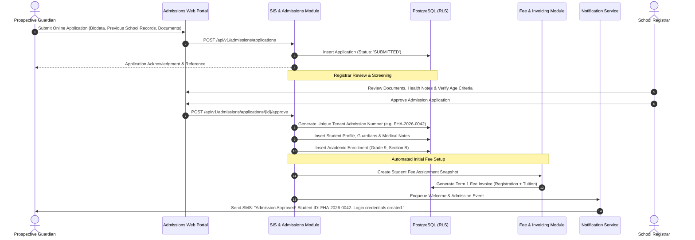
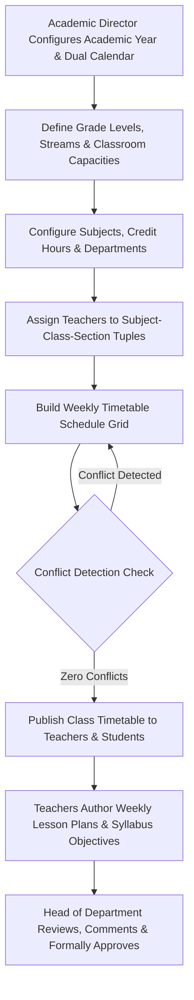
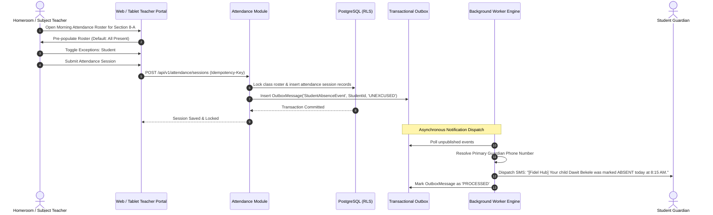
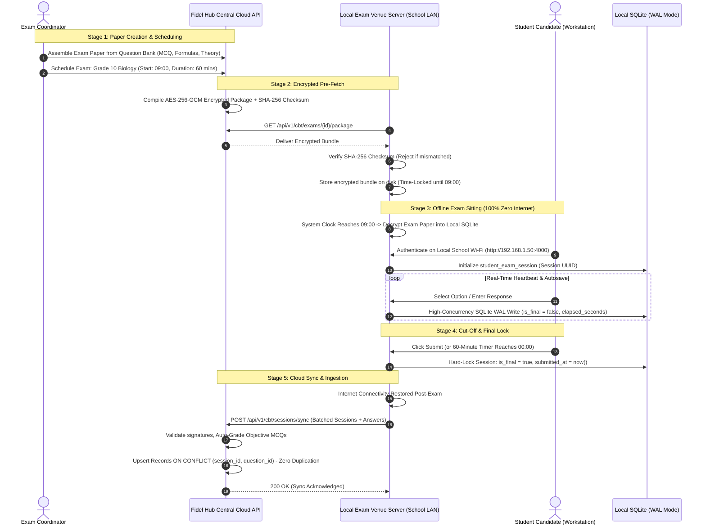
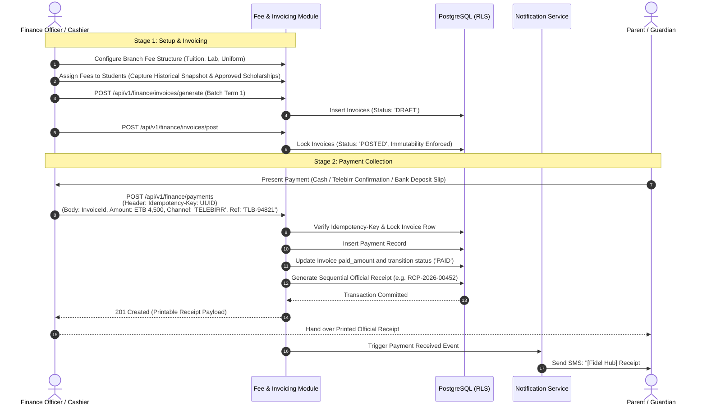

# BUSINESS WORKFLOWS & OPERATIONAL SPECIFICATIONS

## Fidel Hub — Standard Operating Procedures & Lifecycle Workflows

| Document Information | Details |
| :--- | :--- |
| **Document ID** | BWF-001 |
| **Version** | 1.0 |
| **Status** | Approved Baseline |
| **Scope** | End-to-End Operational Lifecycle Across All 10 Modules |

---

## 1. Student Admission & Enrollment Lifecycle



### Operational Invariants:
1. **Three-Part Ethiopian Naming**: Admission records strictly record First Name, Father's Name, and Grandfather's Name.
2. **Historical Enrollment Record**: Student transfers between branches do not delete the historical enrollment; a new enrollment row is inserted referencing the previous enrollment ID.
3. **Fee Rate Immutability**: The initial fee assignment captures an immutable snapshot of approved discount rates and tuition tiers.

---

## 2. Academic Curriculum, Timetable & Lesson Plan Workflow



### Operational Invariants:
1. **Conflict Engine**: Timetable scheduling algorithms prevent double-booking a teacher or a physical room within the same period slot.
2. **Syllabus Tracking**: Teachers submit lesson plans by Friday 5:00 PM; HOD must approve before lesson execution on Monday.

---

## 3. Daily Attendance Tracking & Truancy Escalation



---

## 4. Computer-Based Testing (CBT) & Offline Examination Lifecycle
*(The Flagship Resilient Assessment Engine)*



---

## 5. Continuous Assessment, Gradebook & Dual-Script Report Card Workflow

```mermaid
graph TD
    A[Configure Term CA Components: 15% Quizzes + 35% Midterm + 50% Exam] --> B[Teachers Enter Class Scores in Spreadsheet Gradebook]
    B --> C[CBT Exam Objective Scores Auto-Populated from Assessment Engine]
    C --> D[Teachers Evaluate Subjective Theory Questions using Rubrics]
    D --> E[Affective & Psychomotor Behavioral Traits Scored (1-5 Scale)]
    E --> F[System Aggregates Total Weighted Marks, GPA & Percentiles]
    F --> G[Automatic Computation of Class Rank & Branch Promotion Recommendations]
    G --> H[Principal & Head of Department Review and Lock Gradebook]
    H --> I[Batch PDF Generation: Dual-Script (English + Ge'ez ፊ) with Verification QR]
    I --> J[Publish to Parent Portal & Send Completion Notification SMS]
```

### Report Card Quality Standards:
- Official school branch letterhead and high-resolution logo.
- Multi-column performance table: Subject, Continuous Assessment Total, Final Exam Mark, Term Total, Class Average, and Subject Teacher Remarks.
- Behavioral Traits matrix rating punctuality, neatness, teamwork, and leadership.
- Cryptographic verification QR code encoding `https://verify.fidelhub.com/transcripts/{hash}`.

---

## 6. Student Fee Management, Invoicing & Payment Workflow
*(Strictly Enforcing PRD Scope — No General Ledger Bloat)*



### Financial Business Rules:
1. **Posted Invoice Immutability**: Under no circumstances can a `POSTED` invoice be edited in place. Any reduction must occur via an authorized credit waiver record.
2. **Idempotency Protection**: Flaky internet retry submissions presenting the same `Idempotency-Key` return the existing receipt record without creating duplicate ledger credits.
3. **Branch Financial Boundary**: All fee structures, invoices, and payments belong strictly to authorized branches.
