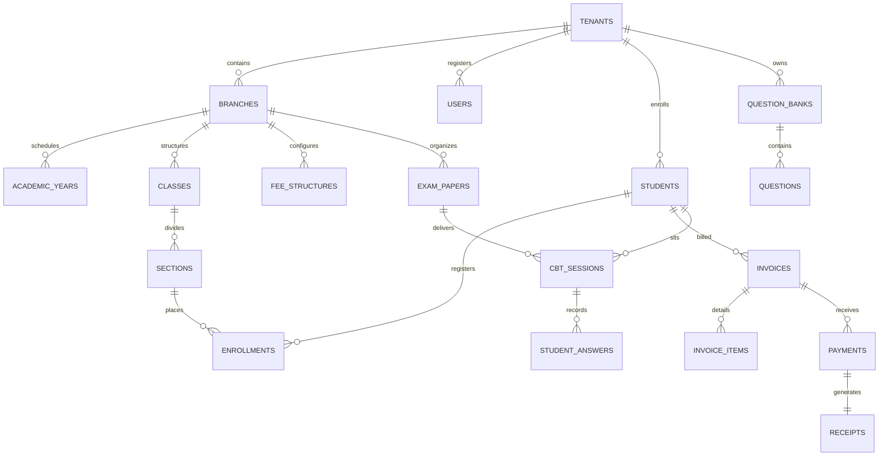
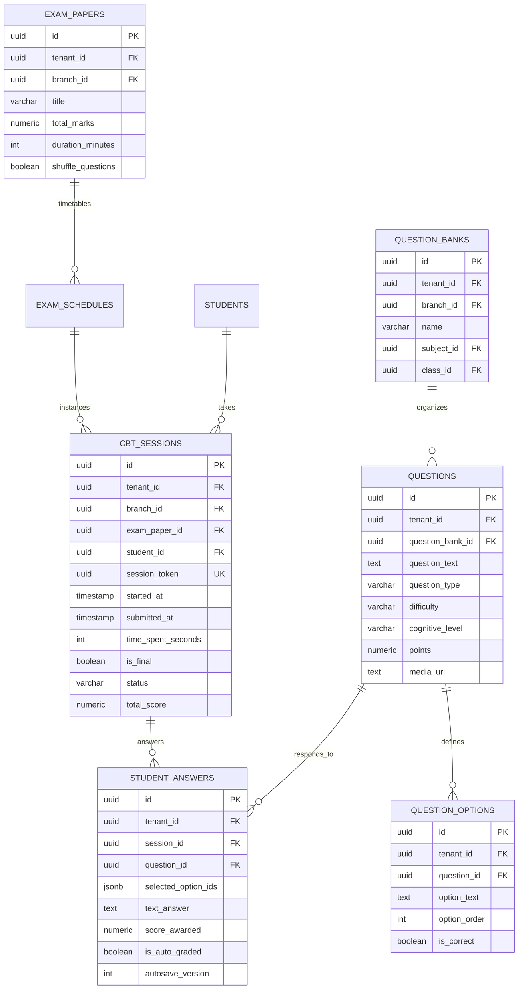
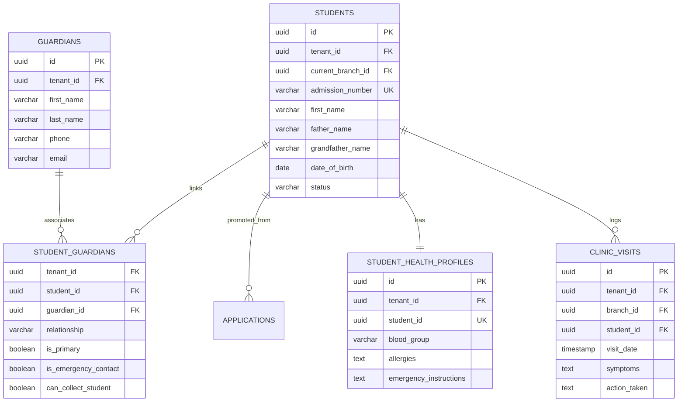
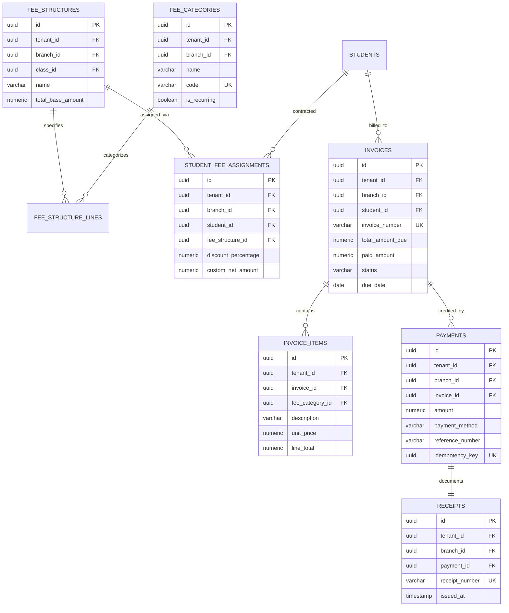
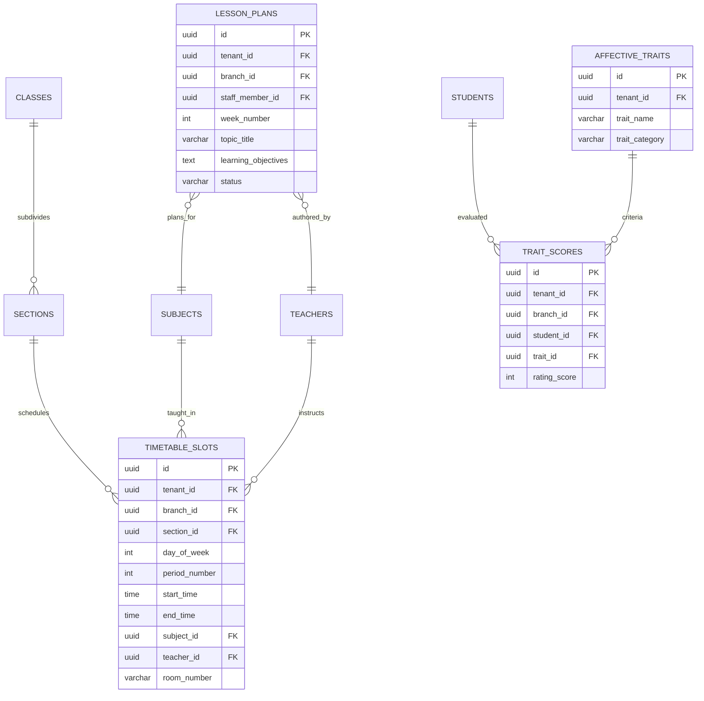
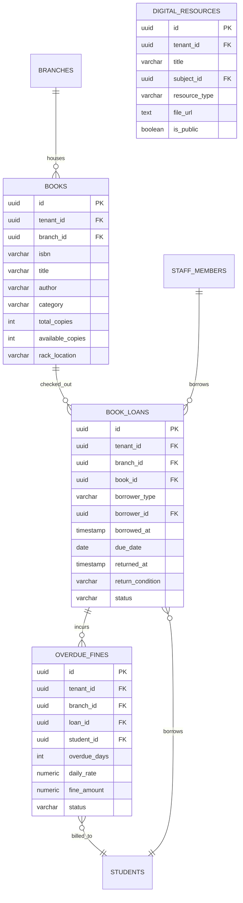
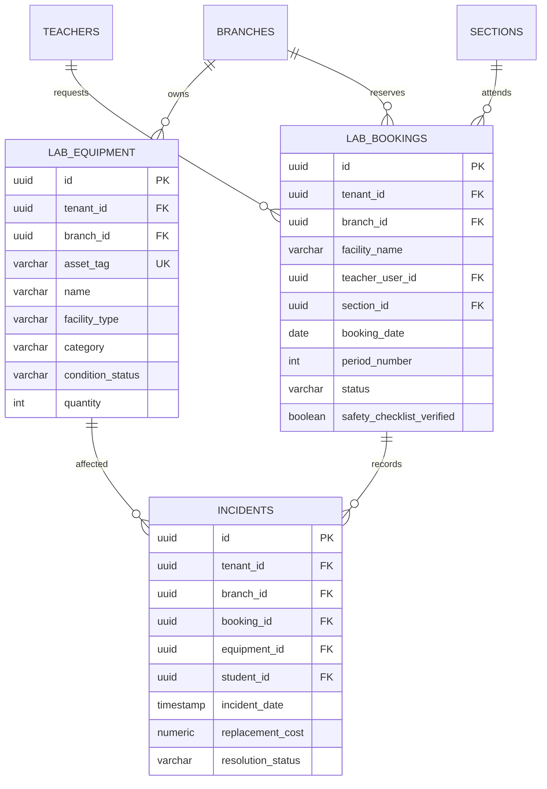
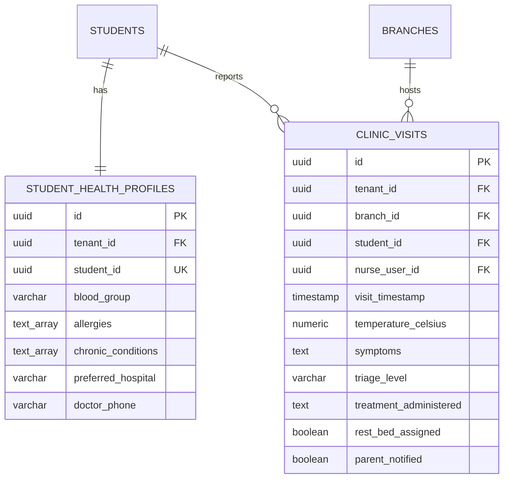
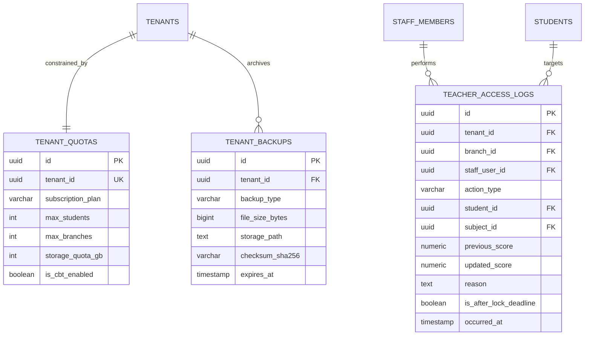

# ENTITY RELATIONSHIP DIAGRAM (ERD)

## Fidel Hub — Relational Schema Models

| Document Information | Details |
| :--- | :--- |
| **Document ID** | ERD-002 |
| **Version** | 1.0 |
| **Status** | Approved Baseline |
| **Target Database** | PostgreSQL 16+ (Multi-Tenant with Row-Level Security) |

---

## 1. High-Level Domain Relationships

---

## 2. Examination, Question Bank & CBT Data Model

---

## 3. Student SIS, Admissions & Health Model

---

## 4. Fee & Invoicing Relational Model (No General Ledger)

---

## 5. Academics, Timetable & Behavioral Traits Model

---

## 6. Library Circulation & Media Resource Model

---

## 7. Facilities, Laboratory & Safety Model

---

## 8. Student Health, Clinic & Emergency Model

---

## 9. Teacher Grade Audit & Platform Subscription Quota Model

