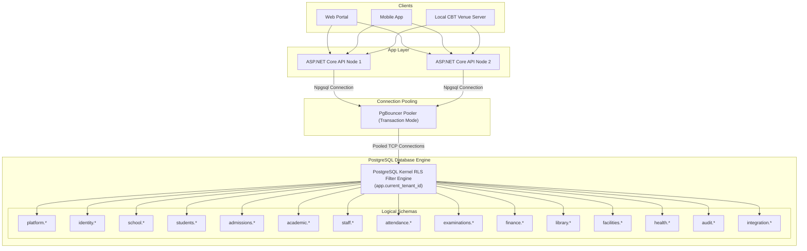

# DATABASE ARCHITECTURE SPECIFICATION

## Fidel Hub — Enterprise Multi-Tenant PostgreSQL Architecture

| Document Information | Details |
| :--- | :--- |
| **Document ID** | DBA-001 |
| **Version** | 1.0 |
| **Status** | Approved Baseline |
| **Database Engine** | PostgreSQL 16+ with Native Row-Level Security (RLS) |
| **Connection Pooler** | PgBouncer (Transaction Pooling Mode) |
| **ORM & Data Access** | Entity Framework Core 10 (.NET 8 LTS) + Dapper for High-Throughput Read Paths |

---

## 1. Architectural Strategy & Physical Topology

Fidel Hub employs a **Shared-Database, Shared-Table Multi-Tenant Architecture** logically partitioned through PostgreSQL schemas. This architecture delivers optimal resource utilization across hundreds of Ethiopian school campuses while guaranteeing **cryptographic-grade tenant isolation at the database kernel level**.



---

## 2. Logical Schema Modularization

The database is divided into 15 domain schemas to enforce clean boundaries between sub-systems:

| Schema Name | Business Domain Responsibility | Key Entities |
| :--- | :--- | :--- |
| `platform` | SaaS operations, school tenant subscriptions, quotas | `tenants`, `tenant_settings`, `tenant_quotas`, `tenant_backups` |
| `identity` | User identity credentials, branch mappings, RBAC roles | `users`, `user_branch_access`, `roles`, `user_roles` |
| `school` | Physical branch campuses, academic calendars, branch settings | `branches`, `branch_settings`, `academic_calendars` |
| `students` | Student demographic master records, guardian mappings | `students`, `guardians`, `student_guardians` |
| `admissions` | Prospective student applications and intake screening | `admission_applications`, `application_documents` |
| `academic` | Class levels, streams, subjects, timetables, lesson plans | `academic_years`, `terms`, `classes`, `sections`, `subjects`, `student_enrollments`, `timetables`, `lesson_plans` |
| `staff` | Academic staff profiles and subject assignments | `staff_members`, `teacher_subjects`, `qualifications` |
| `attendance` | Daily homeroom and period-by-period class attendance | `attendance_sessions`, `attendance_records` |
| `examinations`| Question bank, exam papers, offline CBT sessions | `question_banks`, `questions`, `exam_papers`, `cbt_sessions` |
| `finance` | Student fees, snapshots, invoices, payment receipts | `fee_structures`, `fee_snapshots`, `invoices`, `payments`, `receipts` |
| `library` | Book cataloging, circulation loans, overdue fines | `books`, `book_loans`, `overdue_fines`, `digital_resources` |
| `facilities` | Lab equipment registry, room booking, incident logs | `equipment`, `lab_bookings`, `incidents` |
| `health` | Medical profiles, clinic dispensary visits, rest beds | `student_health_profiles`, `clinic_visits` |
| `audit` | Append-only system telemetry and grade modification audit | `audit_logs`, `teacher_access_logs` |
| `integration` | Outbox message broker and offline CBT batch sync tracking | `outbox_messages`, `offline_cbt_sync_batches` |

---

## 3. Kernel-Level Row-Level Security (RLS) Mechanics

### 3.1 Security Isolation Invariant
Application-level filtering (e.g. `WHERE tenant_id = @tenant_id`) is treated as a secondary defense. The primary, non-negotiable security boundary is enforced **inside the database engine** using PostgreSQL Row-Level Security.

### 3.2 Unprivileged Role Requirement
The application connects to PostgreSQL using an unprivileged role (`fidel_app_user`) that **does not possess `SUPERUSER` or `BYPASSRLS` privileges**:
```sql
CREATE ROLE fidel_app_user WITH LOGIN PASSWORD 'secure_production_password' NOSUPERUSER NOBYPASSRLS;
GRANT CONNECT ON DATABASE fidel_hub_prod TO fidel_app_user;
GRANT USAGE ON SCHEMA platform, identity, school, students, admissions, academic, staff, attendance, examinations, finance, library, facilities, health, audit, integration TO fidel_app_user;
GRANT SELECT, INSERT, UPDATE, DELETE ON ALL TABLES IN SCHEMA platform, identity, school, students, admissions, academic, staff, attendance, examinations, finance, library, facilities, health, audit, integration TO fidel_app_user;
```

### 3.3 Transaction-Scoped Session Variable Injection
To ensure multi-tenant safety when operating with **PgBouncer in Transaction Pooling Mode**, tenant variables are injected using `SET LOCAL`, which automatically scopes variable lifecycle to the current SQL transaction and prevents leakage across pooled connections:

```csharp
// Executed by EF Core DbConnectionInterceptor upon opening every transaction
await using var cmd = connection.CreateCommand();
cmd.Transaction = transaction;
cmd.CommandText = "SET LOCAL app.current_tenant_id = @tenantId; SET LOCAL app.current_branch_id = @branchId;";
cmd.Parameters.Add(new NpgsqlParameter("tenantId", tenantId));
cmd.Parameters.Add(new NpgsqlParameter("branchId", branchId.HasValue ? branchId.Value : DBNull.Value));
await cmd.ExecuteNonQueryAsync();
```

### 3.4 Canonical Policy Definition
Every tenant-scoped table is secured with the following standard policy pattern:
```sql
ALTER TABLE students.students ENABLE ROW LEVEL SECURITY;
ALTER TABLE students.students FORCE ROW LEVEL SECURITY;

CREATE POLICY tenant_isolation_policy ON students.students
    FOR ALL
    TO fidel_app_user
    USING (tenant_id = NULLIF(current_setting('app.current_tenant_id', true), '')::UUID)
    WITH CHECK (tenant_id = NULLIF(current_setting('app.current_tenant_id', true), '')::UUID);
```

---

## 4. High-Performance Indexing & Query Patterns

### 4.1 B-Tree UUIDv7 Indexing Strategy
To avoid B-tree page fragmentation associated with traditional random UUIDv4 identifiers, Fidel Hub utilizes time-ordered UUIDv7 identifiers for high-insertion tables (`attendance.attendance_records`, `examinations.student_answers`, `audit.teacher_access_logs`).

### 4.2 Composite & Partial Indexes
1. **Tenant Compound Indexes**: All multi-column queries lead with `tenant_id`:
   ```sql
   CREATE INDEX ix_students_tenant_branch_status ON students.students (tenant_id, branch_id, status);
   ```
2. **Filtered Partial Indexes**: Partial indexes minimize index size and memory footprint:
   ```sql
   -- Only index unpaid invoices for rapid debt collection lookups
   CREATE INDEX ix_invoices_unpaid ON finance.invoices (tenant_id, branch_id, student_id) 
   WHERE status IN ('POSTED', 'PARTIALLY_PAID');

   -- Only index active book loans for the circulation desk
   CREATE INDEX ix_book_loans_active ON library.book_loans (tenant_id, branch_id, borrower_id) 
   WHERE status = 'ACTIVE';

   -- Only index outbox events awaiting asynchronous dispatch
   CREATE INDEX ix_outbox_unprocessed ON integration.outbox_messages (occurred_at) 
   WHERE processed_at IS NULL;
   ```

---

## 5. High-Throughput Read Paths with Dapper

While EF Core 8 (.NET 8 LTS) is the authoritative write-path ORM (enforcing domain invariants and executing transaction outbox writes), high-throughput reporting and marksheet read operations bypass EF Core change tracking and execute via **Dapper micro-ORM**:

```csharp
public async Task<IReadOnlyList<MarksheetStudentRowDto>> GetMarksheetAsync(Guid sectionId, Guid subjectId, CancellationToken ct)
{
    const string sql = @"
        SELECT s.id AS StudentId, s.admission_number AS AdmissionNumber,
               CONCAT(s.first_name, ' ', s.father_name, ' ', s.grandfather_name) AS FullName,
               g.continuous_assessment_score AS ContinuousAssessmentScore,
               g.final_exam_score AS FinalExamScore,
               g.total_score AS TotalScore,
               g.letter_grade AS LetterGrade
        FROM academic.enrollments e
        JOIN students.students s ON s.id = e.student_id
        LEFT JOIN examinations.term_grades g ON g.enrollment_id = e.id AND g.subject_id = @SubjectId
        WHERE e.section_id = @SectionId AND e.status = 'ACTIVE'
        ORDER BY s.first_name, s.father_name;";

    using var connection = _connectionFactory.CreateConnection();
    return (await connection.QueryAsync<MarksheetStudentRowDto>(sql, new { SectionId = sectionId, SubjectId = subjectId })).AsList();
}
```

---

## 6. Table Partitioning Plan for Massive Scale

To sustain large multi-tenant school networks over multi-year operations, high-velocity tables are partitioned by academic year using PostgreSQL declarative range partitioning:

```sql
-- Partitioning attendance records by academic quarter/year
CREATE TABLE attendance.attendance_records (
    id UUID NOT NULL,
    tenant_id UUID NOT NULL,
    session_id UUID NOT NULL,
    student_id UUID NOT NULL,
    status VARCHAR(20) NOT NULL,
    recorded_at DATE NOT NULL,
    PRIMARY KEY (id, recorded_at)
) PARTITION BY RANGE (recorded_at);

CREATE TABLE attendance.attendance_records_2026 PARTITION OF attendance.attendance_records
    FOR VALUES FROM ('2026-01-01') TO ('2027-01-01');

CREATE TABLE attendance.attendance_records_2027 PARTITION OF attendance.attendance_records
    FOR VALUES FROM ('2027-01-01') TO ('2028-01-01');
```

---

## 7. Database Resiliency & Backup Runbook

1. **Continuous Archiving**: PostgreSQL Write-Ahead Log (WAL) archiving to S3-compatible cloud storage with Point-In-Time Recovery (PITR) up to the minute.
2. **Nightly Physical Backups**: Automated `pg_dump` full database snapshots taken at 02:00 AM East Africa Time (EAT).
3. **Tenant-Level Logical Backups**: Export tenant data using RLS-filtered queries into encrypted standalone archives (`.sql.gz`) for institutional data sovereignty.
