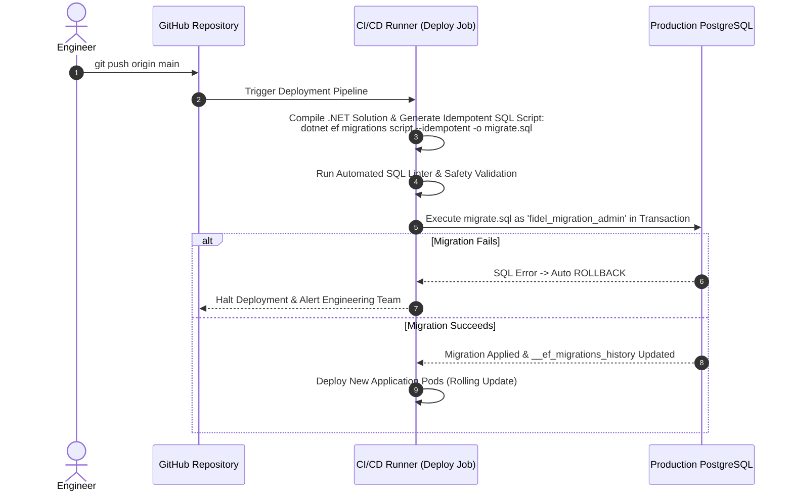

# DATABASE MIGRATION STRATEGY

## Fidel Hub — Database Evolution, Schema Versioning & Deployment Runbook

| Document Information | Details |
| :--- | :--- |
| **Document ID** | DMS-001 |
| **Version** | 1.0 |
| **Status** | Approved Baseline |
| **Migration Engine** | Entity Framework Core 10 Migrations (.NET 8 LTS) + Reviewed Raw SQL Scripts |
| **Deployment Mode** | Zero-Downtime Expand/Contract with PostgreSQL Native Transactions |

---

## 1. Migration Philosophy & Standards

In a multi-tenant enterprise system where hundreds of schools depend on continuous availability, database schema changes must adhere to strict operational standards:

1. **Transactional Execution**: Every migration script must run inside an explicit PostgreSQL transaction block (`BEGIN; ... COMMIT;`). Any failure rolls back the entire migration cleanly.
2. **Deterministic Versioning**: All migrations are stored in source control under `src/backend/FidelHub.Infrastructure/Migrations/` with chronological timestamps.
3. **Migration History Isolation**: EF Core migration history is stored in the `platform` schema:
   ```csharp
   options.UseNpgsql(connectionString, x => x.MigrationsHistoryTable("__ef_migrations_history", "platform"));
   ```
4. **Idempotent Application**: Migration scripts can be run repeatedly without causing errors or data loss (`CREATE TABLE IF NOT EXISTS`, `ADD COLUMN IF NOT EXISTS`).
5. **No Automatic In-App Migration in Production**: `context.Database.Migrate()` is strictly prohibited during ASP.NET Core web startup in production environments. Migrations must be applied by a dedicated CI/CD deployment runner or migration sidecar container before routing traffic to new application pods.

---

## 2. Managing PostgreSQL Row-Level Security in Migrations

Because EF Core's model snapshot engine does not natively model PostgreSQL RLS statements (`ENABLE ROW LEVEL SECURITY`, `CREATE POLICY`), every migration adding a tenant-scoped table must include explicit SQL statements in the `Up()` method:

```csharp
public partial class AddLibrarySchema : Migration
{
    protected override void Up(MigrationBuilder migrationBuilder)
    {
        // 1. Create table via standard EF Core builder
        migrationBuilder.CreateTable(
            name: "books",
            schema: "library",
            columns: table => new
            {
                id = table.Column<Guid>(type: "uuid", nullable: false),
                tenant_id = table.Column<Guid>(type: "uuid", nullable: false),
                branch_id = table.Column<Guid>(type: "uuid", nullable: false),
                title = table.Column<string>(type: "character varying(255)", maxLength: 255, nullable: false),
                author = table.Column<string>(type: "character varying(200)", maxLength: 200, nullable: false),
                category = table.Column<string>(type: "character varying(100)", maxLength: 100, nullable: false),
                total_copies = table.Column<int>(type: "integer", nullable: false, defaultValue: 1),
                available_copies = table.Column<int>(type: "integer", nullable: false, defaultValue: 1),
                created_at = table.Column<DateTimeOffset>(type: "timestamp with time zone", nullable: false),
                updated_at = table.Column<DateTimeOffset>(type: "timestamp with time zone", nullable: false)
            },
            constraints: table =>
            {
                table.PrimaryKey("pk_books", x => x.id);
                table.ForeignKey(
                    name: "fk_books_tenants_tenant_id",
                    column: x => x.tenant_id,
                    principalSchema: "platform",
                    principalTable: "tenants",
                    principalColumn: "id",
                    onDelete: ReferentialAction.Cascade);
            });

        // 2. Attach Mandatory Kernel RLS Policies
        migrationBuilder.Sql(@"
            ALTER TABLE library.books ENABLE ROW LEVEL SECURITY;
            ALTER TABLE library.books FORCE ROW LEVEL SECURITY;

            CREATE POLICY library_books_tenant_isolation ON library.books
                FOR ALL
                TO fidel_app_user
                USING (tenant_id = NULLIF(current_setting('app.current_tenant_id', true), '')::UUID)
                WITH CHECK (tenant_id = NULLIF(current_setting('app.current_tenant_id', true), '')::UUID);
        ");
    }

    protected override void Down(MigrationBuilder migrationBuilder)
    {
        migrationBuilder.Sql("DROP POLICY IF EXISTS library_books_tenant_isolation ON library.books;");
        migrationBuilder.DropTable(name: "books", schema: "library");
    }
}
```

---

## 3. Zero-Downtime Expand-Contract Strategy

To ensure deployments occur without interrupting active student CBT exams or classroom attendance sessions, database changes follow the **Expand/Contract Pattern**:

```mermaid
graph LR
    subgraph Phase 1: Expand
        A1[Deploy Migration: Add new column as NULLABLE] --> A2[Old App and New App both function safely]
    end

    subgraph Phase 2: Transition
        B1[Deploy New App Code] --> B2[New App writes to new column & backfills data]
    end

    subgraph Phase 3: Contract
        C1[Apply Final Migration: Add NOT NULL or Drop deprecated column]
    end

    Phase 1 --> Phase 2 --> Phase 3
```

### Prohibited Operations During Live Traffic:
* ❌ Adding non-nullable columns without default values (`ADD COLUMN column_name TYPE NOT NULL`).
* ❌ Renaming existing active columns or tables directly.
* ❌ Adding unindexed foreign keys on high-traffic tables (causes long-held table locks).
* ❌ Creating indexes without the `CONCURRENTLY` flag in production scripts.

---

## 4. CI/CD Migration Execution Pipeline



---

## 5. Seed Data & System Provisioning Fixtures

System initialization scripts populate fundamental configuration data without manual intervention:

```sql
-- 1. Initialize Standard Institutional Roles
INSERT INTO identity.roles (id, code, name, description) VALUES
    ('00000000-0000-0000-0000-000000000001', 'PLATFORM_SUPERADMIN', 'Platform Super Administrator', 'Global SaaS telemetry and tenant lifecycle.'),
    ('00000000-0000-0000-0000-000000000002', 'TENANT_PRINCIPAL', 'School Principal', 'Tenant-wide academic and administrative authority.'),
    ('00000000-0000-0000-0000-000000000003', 'BRANCH_ADMIN', 'Branch Campus Administrator', 'Campus-scoped day-to-day operations.'),
    ('00000000-0000-0000-0000-000000000004', 'HEAD_OF_DEPARTMENT', 'Head of Department', 'Curriculum review and lesson plan approval.'),
    ('00000000-0000-0000-0000-000000000005', 'TEACHER', 'Classroom Teacher', 'Attendance, gradebook entry, and exam authoring.'),
    ('00000000-0000-0000-0000-000000000006', 'EXAM_COORDINATOR', 'CBT Exam Coordinator', 'Paper assembly and venue server unlocking.'),
    ('00000000-0000-0000-0000-000000000007', 'CASHIER', 'School Cashier', 'Fee structures, invoices, and payment receipting.'),
    ('00000000-0000-0000-0000-000000000008', 'REGISTRAR', 'Registrar Officer', 'Admissions, student records, and guardian links.'),
    ('00000000-0000-0000-0000-000000000009', 'LIBRARIAN', 'School Librarian', 'Book cataloging, lending desk, and overdue fines.'),
    ('00000000-0000-0000-0000-000000000010', 'LAB_TECHNICIAN', 'Laboratory Technician', 'Lab apparatus, chemical stocks, and room bookings.'),
    ('00000000-0000-0000-0000-000000000011', 'SCHOOL_NURSE', 'School Health Officer', 'Student clinic visits, vitals, and emergency triage.'),
    ('00000000-0000-0000-0000-000000000012', 'PARENT', 'Parent / Guardian', 'Attendance notifications, report cards, fee payments.'),
    ('00000000-0000-0000-0000-000000000013', 'STUDENT', 'Enrolled Student', 'CBT assessments, timetables, and academic grades.')
ON CONFLICT (code) DO NOTHING;

-- 2. Initialize Core Affective Trait Rubrics
INSERT INTO academic.affective_traits (id, tenant_id, trait_name, trait_category) VALUES
    (gen_random_uuid(), '00000000-0000-0000-0000-000000000000', 'Punctuality & Regularity', 'BEHAVIORAL'),
    (gen_random_uuid(), '00000000-0000-0000-0000-000000000000', 'Neatness & Personal Hygiene', 'BEHAVIORAL'),
    (gen_random_uuid(), '00000000-0000-0000-0000-000000000000', 'Honesty & Integrity', 'ETHICAL'),
    (gen_random_uuid(), '00000000-0000-0000-0000-000000000000', 'Teamwork & Cooperation', 'SOCIAL'),
    (gen_random_uuid(), '00000000-0000-0000-0000-000000000000', 'Leadership & Initiative', 'SOCIAL')
ON CONFLICT DO NOTHING;
```

---

## 6. Rollback & Emergency Disaster Recovery

1. **Transaction Auto-Abort**: Because migrations execute in transactions, syntax errors or constraint violations cause an immediate automatic rollback with zero alterations applied.
2. **Reverting Staged Code**: If a production issue arises after a zero-downtime expand deployment, deploy the previous application version. Since the database was only expanded (with nullable columns), the older application continues to function normally.
3. **Database Point-in-Time Recovery (PITR)**: For catastrophic failures, restore PostgreSQL to a timestamp immediately preceding the migration deployment window utilizing continuous WAL archives.
