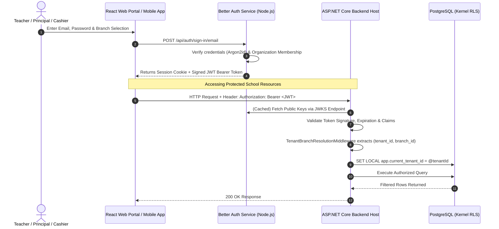

# AUTHENTICATION & AUTHORIZATION SPECIFICATION

## Fidel Hub — Better Auth Service Integration & Multi-Tenancy Enforcement

| Document Information | Details |
| :--- | :--- |
| **Document ID** | AUT-001 |
| **Version** | 1.0 |
| **Status** | Approved Baseline |
| **Auth Engine** | Better Auth (Node.js/PostgreSQL) with Organizations & JWT Plugins |
| **Token Format** | Cryptographically Signed JWT (RS256 / EdDSA) with JWKS |
| **Authorization Engine** | ASP.NET Core Policy-Based Handlers + PostgreSQL Kernel RLS |
| **Framework & SDK** | .NET 10 LTS (`net10.0`) |
| **Prerequisites** | Developers must install .NET 10 SDK or higher. |
| **Package Dependencies** | `Microsoft.AspNetCore.Authentication.JwtBearer: 10.x`, `Microsoft.AspNetCore.*: 10.x` |
| **Container Base Images** | `mcr.microsoft.com/dotnet/aspnet:10.0` (runtime), `mcr.microsoft.com/dotnet/sdk:10.0` (build) |

---

## 1. Authentication Topology & Trust Boundary

Fidel Hub delegates identity lifecycle, credentials storage, multi-factor authentication (MFA), and session issuance to a dedicated **Better Auth service**. The ASP.NET Core backend acts as a **stateless Resource Server**, validating issued JWT tokens against Better Auth's JSON Web Key Set (JWKS) endpoint:



---

## 2. Better Auth JWT Token Claims Contract

Every JWT token issued by Better Auth contains the explicit multi-tenancy and branch context necessary for authorization:

```json
{
  "iss": "https://auth.fidelhub.com",
  "sub": "b2f6c0a8-4e12-4d56-9812-7a541289de01",
  "email": "solomon.teacher@fidelhub.com",
  "name": "Solomon Bekele Hailu",
  "tenant_id": "11111111-1111-1111-1111-111111111111",
  "branch_id": "22222222-2222-2222-2222-222222222222",
  "roles": [
    "TEACHER",
    "EXAM_COORDINATOR"
  ],
  "permissions": [
    "att.session.take",
    "grade.marksheet.enter",
    "exam.question.create",
    "exam.cbt.package.export",
    "lib.loan.checkout"
  ],
  "exp": 1793540400,
  "iat": 1793504400
}
```

---

## 3. ASP.NET Core Resource Server Configuration

The ASP.NET Core host validates the Better Auth JWT using standard `Microsoft.AspNetCore.Authentication.JwtBearer`:

```csharp
namespace FidelHub.Web.Extensions;

public static class AuthenticationExtensions
{
    public static IServiceCollection AddFidelHubAuthentication(this IServiceCollection services, IConfiguration configuration)
    {
        var authOptions = configuration.GetSection("BetterAuth").Get<BetterAuthOptions>()!;

        services.AddAuthentication(JwtBearerDefaults.AuthenticationScheme)
            .AddJwtBearer(options =>
            {
                options.Authority = authOptions.Issuer;
                options.Audience = authOptions.Audience;
                options.RequireHttpsMetadata = true;
                
                options.TokenValidationParameters = new TokenValidationParameters
                {
                    ValidateIssuer = true,
                    ValidIssuer = authOptions.Issuer,
                    ValidateAudience = true,
                    ValidAudience = authOptions.Audience,
                    ValidateLifetime = true,
                    ValidateIssuerSigningKey = true,
                    ClockSkew = TimeSpan.FromSeconds(5) // Strict clock tolerance
                };
            });

        return services;
    }
}
```

---

## 4. Tenant & Branch Resolution Middleware

The middleware executes on every incoming request, validates the claims, and establishes the ambient tenant execution context:

```csharp
namespace FidelHub.Web.Middlewares;

public class TenantBranchResolutionMiddleware
{
    private readonly RequestDelegate _next;

    public TenantBranchResolutionMiddleware(RequestDelegate next) => _next = next;

    public async Task InvokeAsync(HttpContext context, ICurrentTenantContext tenantContext, ILogger<TenantBranchResolutionMiddleware> logger)
    {
        if (context.User.Identity?.IsAuthenticated == true)
        {
            var tenantClaim = context.User.FindFirst("tenant_id")?.Value;
            var branchClaim = context.User.FindFirst("branch_id")?.Value;
            var userIdClaim = context.User.FindFirst(ClaimTypes.NameIdentifier)?.Value 
                              ?? context.User.FindFirst("sub")?.Value;

            if (string.IsNullOrEmpty(tenantClaim) || !Guid.TryParse(tenantClaim, out var tenantId))
            {
                context.Response.StatusCode = StatusCodes.Status401Unauthorized;
                await context.Response.WriteAsJsonAsync(new { error = "Missing or invalid tenant_id in token." });
                return;
            }

            Guid? branchId = Guid.TryParse(branchClaim, out var bId) ? bId : null;
            Guid.TryParse(userIdClaim, out var userId);

            // Establish ambient tenant context for EF Core and Dapper
            tenantContext.Initialize(tenantId, branchId, userId);
        }

        await _next(context);
    }
}
```

---

## 5. Granular Policy-Based Authorization Handlers

Endpoint capabilities are guarded by granular permission attributes:

```csharp
namespace FidelHub.Web.Authorization;

public class RequirePermissionAttribute : AuthorizeAttribute
{
    public RequirePermissionAttribute(string permission) : base(policy: permission) { }
}

public class PermissionRequirement : IAuthorizationRequirement
{
    public string Permission { get; }
    public PermissionRequirement(string permission) => Permission = permission;
}

public class PermissionAuthorizationHandler : AuthorizationHandler<PermissionRequirement>
{
    protected override Task HandleRequirementAsync(AuthorizationHandlerContext context, PermissionRequirement requirement)
    {
        var permissionClaims = context.User.FindAll("permissions").Select(c => c.Value);
        if (permissionClaims.Contains(requirement.Permission, StringComparer.OrdinalIgnoreCase))
        {
            context.Succeed(requirement);
        }
        return Task.CompletedTask;
    }
}
```

### Controller Usage:
```csharp
[ApiController]
[Route("api/v1/library/loans")]
public class LibraryLoansController : ControllerBase
{
    [HttpPost("checkout")]
    [RequirePermission("lib.loan.checkout")]
    public async Task<IActionResult> CheckoutBook([FromBody] CheckoutBookCommand command)
    {
        var result = await Mediator.Send(command);
        return Ok(ApiResponse.Created(result));
    }
}
```
