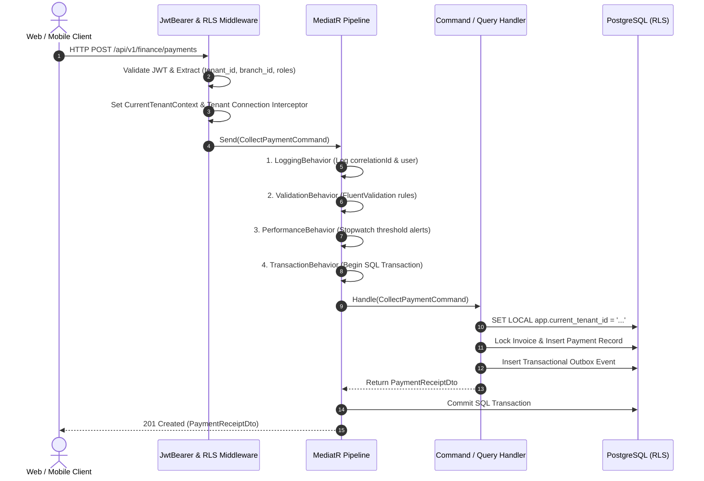

# BACKEND ARCHITECTURE SPECIFICATION

## Fidel Hub — ASP.NET Core Modular Monolith Architecture

| Document Information | Details |
| :--- | :--- |
| **Document ID** | BDA-001 |
| **Version** | 1.0 |
| **Status** | Approved Baseline |
| **Framework** | .NET 8 LTS (`net8.0`) / ASP.NET Core 10 / EF Core 8 |
| **Prerequisites** | Developers must install .NET 8 LTS SDK or higher. |
| **Package Dependencies** | `Microsoft.AspNetCore.*: 10.x`, `Microsoft.EntityFrameworkCore.*: 10.x` |
| **Container Images** | `mcr.microsoft.com/dotnet/aspnet:10.0`, `mcr.microsoft.com/dotnet/sdk:10.0` |
| **Architecture Style** | Domain-Driven Modular Monolith (Vertical Slices + CQRS) |
| **Data Access** | EF Core 8 (Write Path) + Dapper (High-Throughput Read Path) |

---

## 1. Architectural Philosophy & Monolith Topology

Fidel Hub is built as a **Domain-Driven Modular Monolith**. Rather than adopting microservice sprawl—which introduces operational complexity, distributed transaction failures, and deployment overhead—the backend codebase is partitioned into **loosely coupled, highly cohesive in-process modules**.

```mermaid
graph TD
    subgraph Host Process [ASP.NET Core Web API Host]
        Middleware["Tenant & Branch RLS Interceptor Middleware"]
        AuthModule["Better Auth Token Handler & Claims Principal"]
        
        subgraph In-Process Modules
            M01["Organization & Branches"]
            M02["Identity & Access Control"]
            M03["Student SIS & Admissions"]
            M04["Academics, Curriculum & Timetable"]
            M05["Attendance Management"]
            M06["Question Bank & CBT Assessment Engine"]
            M07["Grading, Marksheets & Report Cards"]
            M08["Student Fee Management & Invoicing"]
            M09["Communications & Notification Gateway"]
            M10["Reporting, Transcripts & Analytics"]
            M11["Library & Media Resource Management"]
            M12["Facilities & Laboratory Safety"]
            M13["Student Health & Clinic Dispensary"]
            M14["Teacher Grade Modification Audit"]
            M15["Platform SuperAdmin & Quotas"]
        end
        
        MediatR["In-Memory Mediator & Event Bus (MediatR)"]
        OutboxWorker["Transactional Outbox Background Processor"]
    end

    subgraph Data Stores
        PG[(PostgreSQL 16+ with RLS)]
        Redis[(Redis Cache & Distributed Locks)]
    end

    Middleware --> AuthModule
    AuthModule --> MediatR
    MediatR --> M01 & M02 & M03 & M04 & M05 & M06 & M07 & M08 & M09 & M10 & M11 & M12 & M13 & M14 & M15
    M01 & M02 & M03 & M04 & M05 & M06 & M07 & M08 & M09 & M10 & M11 & M12 & M13 & M14 & M15 -.-> PG
    Host Process -.-> Redis
    OutboxWorker --> PG
```

### Core Invariants:
1. **Independent Module Boundaries**: Modules communicate across boundaries exclusively via in-memory MediatR Commands/Queries or asynchronous Domain Events. Direct cross-module database joins or entity references are strictly forbidden.
2. **Dual-Path Data Access (CQRS)**:
   - **Command Write Path**: Uses EF Core 8 to enforce rich domain business logic, validate invariants, and atomically write domain events to `integration.outbox_messages`.
   - **Query Read Path**: Uses **Dapper** with raw parameterized SQL to project directly into flat DTOs, bypassing entity materialization and change tracking for maximum read performance.

---

## 2. Solution & Project Structure

The codebase is standardized on a **Per-Module Vertical Slice Project Layout** using the unified **`FidelHub.*`** naming convention (.NET 8 LTS):

```
backend/
├── FidelHub.sln                             # Unified Visual Studio / dotnet Solution
│
├── FidelHub.Api/                            # ASP.NET Core 10 Web API Host Process
│   ├── Controllers/ / Endpoints/            # Thin HTTP route mappings & Swagger metadata
│   ├── Middlewares/                         # TenantBranchResolutionMiddleware, ProblemDetailsMiddleware
│   ├── Extensions/                          # Authentication, OpenTelemetry, Sentry, RateLimiter setup
│   └── Program.cs                           # App startup, DI composition root, module discovery
│
├── FidelHub.Shared/                         # Shared Kernel & Cross-Cutting Infrastructure
│   ├── Kernel/                              # ITenantScoped, IBranchScoped, IAuditableEntity, BaseEntity<TId>
│   ├── Context/                             # ICurrentTenantContext & ambient resolution
│   ├── Events/                              # IDomainEvent, IDomainEventHandler, INotification
│   ├── Primitives/                          # Result<T>, Error, ValueObject, StronglyTypedId
│   ├── Infrastructure/
│   │   ├── Data/                            # Multi-Tenant Connection Interceptor, Npgsql DataSource
│   │   ├── Outbox/                          # OutboxMessage entity and EF Core configuration
│   │   └── Caching/                         # Redis cache service & distributed locks
│   └── Behaviors/                           # LoggingBehavior, ValidationBehavior, TransactionBehavior
│
├── FidelHub.Worker/                         # Background Quartz.NET Hosted Service
│   ├── Outbox/                              # OutboxProcessorBackgroundService
│   ├── Sync/                                # CBT Offline Sync Batch Ingestion Worker
│   └── Program.cs                           # Worker DI composition & background job scheduling
│
├── Modules/                                 # 15 Isolated Domain Modules (Vertical Slices)
│   ├── FidelHub.Modules.Tenants/            # 01: School organizations, branches, calendar
│   ├── FidelHub.Modules.Identity/           # 02: Better Auth JWT consumer, user branch access, PBAC
│   ├── FidelHub.Modules.Students/           # 03: Tenant-owned student biodata, guardians, documents
│   ├── FidelHub.Modules.Admissions/         # 03: Intake applications, evaluation, enrollment
│   ├── FidelHub.Modules.Academics/          # 04: Grade levels, sections, timetables, lesson plans, traits
│   ├── FidelHub.Modules.Attendance/         # 05: Daily and period student attendance rosters
│   ├── FidelHub.Modules.Examinations/       # 06: Question Bank, CBT papers, offline sync ingestion
│   ├── FidelHub.Modules.Grading/            # 07: Marksheets, continuous assessment, report card generation
│   ├── FidelHub.Modules.Finance/            # 08: Fee structures, student snapshots, invoices, payments (No GL)
│   ├── FidelHub.Modules.Communication/      # 09: SMS/Push notifications, Ethio Telecom gateway, Resend
│   ├── FidelHub.Modules.Reporting/          # 10: Executive dashboards, MOE compliance transcripts
│   ├── FidelHub.Modules.Library/            # 11: (Phase 2) Books, physical catalog, loans, overdue fines
│   ├── FidelHub.Modules.Facilities/         # 12: (Phase 2) Lab apparatus, ICT equipment, bookings, safety
│   ├── FidelHub.Modules.Health/             # 13: (Phase 2) Student clinic dispensary, vitals, triage visits
│   ├── FidelHub.Modules.Audit/              # 14: (Phase 2) Teacher grade alteration audit telemetry
│   └── FidelHub.Modules.Platform/           # 15: (Phase 2) Multi-tenant SaaS provisioning, quotas
│
└── tests/
    ├── FidelHub.ArchitectureTests/          # NetArchTest enforcing vertical slice boundaries & no cyclic refs
    ├── FidelHub.UnitTests/                  # Domain invariant unit tests (Value objects, entities)
    └── FidelHub.IntegrationTests/           # WebApplicationFactory integration tests with Testcontainers PG
```

---

## 3. Request Execution Pipeline & MediatR Behaviors

Every HTTP request traverses an automated pipeline enforcing authentication, tenant context injection, validation, and performance monitoring:



---

## 4. Transactional Outbox Pattern for Asynchronous Events

To ensure 100% reliable event publishing without distributed transaction two-phase commit overhead, state mutations and event publishing share a single database transaction:

```csharp
namespace FidelHub.Worker.Outbox;

public class OutboxProcessorBackgroundService : BackgroundService
{
    private readonly IServiceProvider _serviceProvider;
    private readonly ILogger<OutboxProcessorBackgroundService> _logger;

    public OutboxProcessorBackgroundService(IServiceProvider serviceProvider, ILogger<OutboxProcessorBackgroundService> logger)
    {
        _serviceProvider = serviceProvider;
        _logger = logger;
    }

    protected override async Task ExecuteAsync(CancellationToken stoppingToken)
    {
        while (!stoppingToken.IsCancellationRequested)
        {
            try
            {
                using var scope = _serviceProvider.CreateScope();
                var db = scope.ServiceProvider.GetRequiredService<FidelHubDbContext>();
                var publisher = scope.ServiceProvider.GetRequiredService<IPublisher>();

                var pendingMessages = await db.Set<OutboxMessage>()
                    .Where(m => m.ProcessedAtUtc == null && m.RetryCount < 5)
                    .OrderBy(m => m.OccurredAtUtc)
                    .Take(50)
                    .ToListAsync(stoppingToken);

                foreach (var message in pendingMessages)
                {
                    try
                    {
                        var eventType = Type.GetType(message.EventType);
                        if (eventType != null)
                        {
                            var domainEvent = JsonSerializer.Deserialize(message.Payload, eventType);
                            if (domainEvent != null)
                            {
                                await publisher.Publish(domainEvent, stoppingToken);
                            }
                        }
                        message.MarkProcessed();
                    }
                    catch (Exception ex)
                    {
                        message.RecordError(ex.Message);
                        _logger.LogError(ex, "Failed to process outbox message {MessageId}", message.Id);
                    }
                }

                await db.SaveChangesAsync(stoppingToken);
            }
            catch (Exception ex)
            {
                _logger.LogError(ex, "Error in outbox processing loop");
            }

            await Task.Delay(TimeSpan.FromSeconds(2), stoppingToken);
        }
    }
}
```

---

## 5. Resilience & Fault Tolerance with Polly

All outbound network calls (SMS gateways, push notification services, and Better Auth JWKS lookups) are wrapped in **Polly resilience pipelines**:

```csharp
services.AddResiliencePipeline("sms-gateway-pipeline", builder =>
{
    builder
        .AddRetry(new RetryStrategyOptions
        {
            MaxRetryAttempts = 3,
            Delay = TimeSpan.FromSeconds(2),
            BackoffType = DelayBackoffType.Exponential,
            UseJitter = true
        })
        .AddCircuitBreaker(new CircuitBreakerStrategyOptions
        {
            FailureRatio = 0.5,
            SamplingDuration = TimeSpan.FromSeconds(30),
            MinimumThroughput = 10,
            BreakDuration = TimeSpan.FromSeconds(60)
        })
        .AddTimeout(TimeSpan.FromSeconds(5));
});
```

---

## 6. Distributed Caching & Performance Strategy

* **Redis Distributed Cache**:
  - School tenant profiles, branch configurations, and academic calendar boundaries are cached with a 1-hour sliding expiration.
  - Better Auth public JWKS keys are cached with a 24-hour TTL, auto-refreshed upon key rotation.
* **Distributed Locks (`RedLock`)**:
  - Used during fee structure generation and exam paper publishing to prevent concurrent duplicate execution across multiple API replicas.

---

## 7. Transactional Email Dispatch with Resend

Transactional emails (fee payment receipts, invoice statements, and term report cards) are processed via **Resend** using strongly-typed React Email components:

```csharp
namespace FidelHub.Modules.Communication.Infrastructure;

public class ResendEmailService : IEmailService
{
    private readonly HttpClient _httpClient;
    private readonly string _apiKey;

    public ResendEmailService(HttpClient httpClient, IConfiguration configuration)
    {
        _httpClient = httpClient;
        _apiKey = configuration["Resend:ApiKey"]!;
    }

    public async Task SendInvoiceReceiptAsync(string toEmail, string studentName, string receiptNumber, decimal amount, byte[] pdfReceipt, CancellationToken ct)
    {
        var payload = new
        {
            from = "Fidel Hub <billing@fidelhub.com>",
            to = new[] { toEmail },
            subject = $"Payment Receipt: {receiptNumber} for {studentName}",
            html = $"<p>Dear Parent,</p><p>We have confirmed payment of <strong>{amount} ETB</strong>. Receipt #{receiptNumber} is attached.</p>",
            attachments = new[]
            {
                new { filename = $"Receipt-{receiptNumber}.pdf", content = Convert.ToBase64String(pdfReceipt) }
            }
        };

        var request = new HttpRequestMessage(HttpMethod.Post, "https://api.resend.com/emails");
        request.Headers.Authorization = new AuthenticationHeaderValue("Bearer", _apiKey);
        request.Content = JsonContent.Create(payload);

        var response = await _httpClient.SendAsync(request, ct);
        response.EnsureSuccessStatusCode();
    }
}
```

---

## 8. Full-Stack Telemetry & Error Tracing with Sentry

Both the ASP.NET Core API host and background worker services integrate **Sentry** for real-time observability:

```csharp
// Program.cs configuration
builder.WebHost.UseSentry(options =>
{
    options.Dsn = builder.Configuration["Sentry:Dsn"];
    options.TracesSampleRate = 0.2; // 20% performance trace sampling
    options.ConfigureScope(scope =>
    {
        scope.SetTag("service", "fidel-hub-api");
    });
});
```

* **Tenant-Scoped Tracing**: Interceptors enrich Sentry scopes with `tenant_id` and `branch_id` on every HTTP request, allowing instant debugging of tenant-specific issues without leaking PII.
* **Database Query Performance**: Npgsql integration automatically logs slow queries (> 200ms) directly to Sentry Performance dashboards.

---

## 9. AI-Assisted Assessment Workflows with Vercel AI SDK

The backend hosts integration endpoints for the **Vercel AI SDK** to power educational assistance:
1. **Question Generation**: Parses national curriculum PDF chapters and outputs structured JSON conforming to Question aggregate models.
2. **Theory Rubric Evaluation**: Analyzes student essay submissions against teacher-defined marking criteria and keyword rubrics, proposing a score and explanatory feedback.