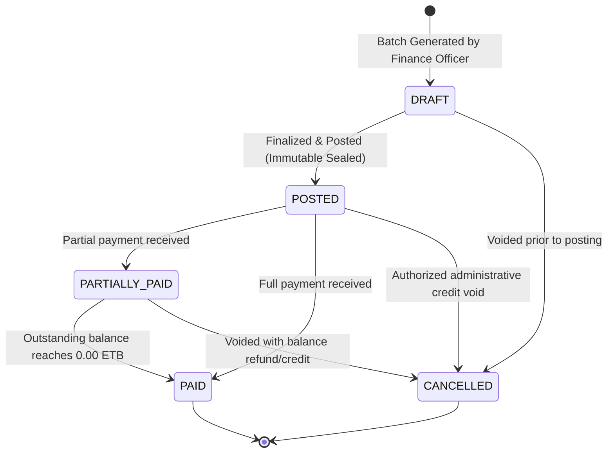

# FINANCIAL INTEGRITY & INVOICING SPECIFICATION

## Fidel Hub — High-Integrity Student Fee Management & Invoicing Engine

| Document Information | Details |
| :--- | :--- |
| **Document ID** | FIN-001 |
| **Version** | 1.0 |
| **Status** | Approved Baseline |
| **Product Scope** | Student Fee & Invoicing Engine (Strictly Non-General Ledger) |
| **Primary Currency** | Ethiopian Birr (ETB) stored as `NUMERIC(14,2)` |
| **Integrity Model** | Snapshot Agreements, Immutable Invoices & Idempotent Payment Receipts |

---

## 1. Architectural Scope & Explicit Invariants

As mandated by **PRD Section 5.12**, Fidel Hub operates a high-integrity **Student Fee Management & Invoicing Engine**. It deliberately avoids the complexity, operational overhead, and error surface of a full double-entry General Ledger (GL) accounting system:

```
+-----------------------------------------------------------------------------------+
| FIDEL HUB FINANCIAL ENGINE (STRICT IN-SCOPE)                                      |
|  - Fee Category & Structure Catalogs (Tuition, Lab, Transport, Uniform)           |
|  - Immutable Student Fee Assignment Snapshots (Scholarships & Sibling Discounts)  |
|  - Batch Term Invoice Generation with Status State Machine                        |
|  - Idempotent Payment Collection (Cash, Telebirr, CBE, Bank Slip)                |
|  - Sequential Official Receipt Generation                                         |
|  - Student Ledger Balance Statements & Clearance Auditing                         |
+-----------------------------------------------------------------------------------+
                                        vs
+-----------------------------------------------------------------------------------+
| EXPLICIT NON-GOALS (OUT OF SCOPE PER PRD)                                         |
|  - Double-Entry General Ledger with Charts of Accounts (Assets, Liabilities, etc.)|
|  - Journal Entries, Trial Balances, Balance Sheets & Profit/Loss Statements        |
|  - Staff Payroll, Wage Tax Deductions & Pension Disbursements                      |
|  - Vendor Procurement, Asset Depreciation & Accounts Payable                       |
+-----------------------------------------------------------------------------------+
```

---

## 2. Core Integrity Principles

### Principle 1: Posted Invoice Immutability
Once an invoice transitions from `DRAFT` to `POSTED`, its line items, subtotal, and total due are **permanently sealed**. No user, administrator, or API call may update or delete a posted invoice row in the database:
```sql
CREATE OR REPLACE FUNCTION finance.prevent_posted_invoice_update()
RETURNS TRIGGER AS $$
BEGIN
    IF OLD.status IN ('POSTED', 'PARTIALLY_PAID', 'PAID') AND (
        NEW.total_amount_due <> OLD.total_amount_due OR
        NEW.student_id <> OLD.student_id OR
        NEW.tenant_id <> OLD.tenant_id
    ) THEN
        RAISE EXCEPTION 'Financial Integrity Violation: Posted invoice records cannot be modified in place. Use credit adjustments or waivers.';
    END IF;
    RETURN NEW;
END;
$$ LANGUAGE plpgsql;

CREATE TRIGGER trg_posted_invoice_immutable
    BEFORE UPDATE ON finance.invoices
    FOR EACH ROW EXECUTE FUNCTION finance.prevent_posted_invoice_update();
```

### Principle 2: Student Fee Assignment Snapshots
When fees are configured for an enrolled student, the system creates an immutable historical fee snapshot. If the school board raises standard tuition rates mid-year, existing signed student term agreements remain unaffected.

### Principle 3: Mandatory Idempotency on Payment Mutations
Network instability in Ethiopian school environments can cause cashiers to click "Submit Payment" multiple times. To eliminate double-charging:
* The client generates a unique UUID `Idempotency-Key` header with every payment request.
* PostgreSQL enforces `UNIQUE (tenant_id, idempotency_key)` on `finance.payments`.
* A replayed request returns the existing payment receipt immediately without inserting duplicate credits.

---

## 3. Invoice Lifecycle State Machine



---

## 4. Payment Collection & Receipt Sequence Generation

Payments are processed within serializable database transactions that lock the invoice row, apply payments, and generate official sequential receipt numbers:

```csharp
namespace FidelHub.Application.Features.Finance;

public class CollectPaymentCommandHandler : IRequestHandler<CollectPaymentCommand, PaymentReceiptDto>
{
    private readonly FidelHubDbContext _db;
    private readonly ICurrentTenantContext _tenantContext;

    public CollectPaymentCommandHandler(FidelHubDbContext db, ICurrentTenantContext tenantContext)
    {
        _db = db;
        _tenantContext = tenantContext;
    }

    public async Task<PaymentReceiptDto> Handle(CollectPaymentCommand request, CancellationToken ct)
    {
        // 1. Check idempotency key to prevent double charge
        var existingPayment = await _db.Payments
            .AsNoTracking()
            .FirstOrDefaultAsync(p => p.IdempotencyKey == request.IdempotencyKey, ct);

        if (existingPayment != null)
        {
            var existingReceipt = await _db.Receipts.FirstAsync(r => r.PaymentId == existingPayment.Id, ct);
            return MapToReceiptDto(existingPayment, existingReceipt);
        }

        // 2. Lock invoice row for update
        var invoice = await _db.Invoices
            .Include(i => i.Payments)
            .FirstOrDefaultAsync(i => i.Id == request.InvoiceId, ct)
            ?? throw new NotFoundException("Invoice not found.");

        if (request.Amount <= 0)
            throw new ValidationException("Payment amount must be greater than zero.");

        if (request.Amount > invoice.BalanceDue)
            throw new ValidationException($"Payment amount ({request.Amount} ETB) exceeds outstanding balance ({invoice.BalanceDue} ETB).");

        // 3. Apply payment and transition invoice status
        invoice.ApplyPayment(request.Amount);

        var payment = new Payment(
            Guid.NewGuid(),
            _tenantContext.TenantId,
            invoice.BranchId,
            invoice.Id,
            request.Amount,
            request.PaymentChannel, // CASH, TELEBIRR, CBE_BIRR, BANK_SLIP
            request.ReferenceNumber,
            request.IdempotencyKey,
            _tenantContext.UserId
        );

        _db.Payments.Add(payment);

        // 4. Generate sequential receipt number (e.g., RCP-2026-00452)
        var receiptNumber = await GenerateSequentialReceiptNumberAsync(invoice.BranchId, ct);
        var receipt = new Receipt(Guid.NewGuid(), _tenantContext.TenantId, invoice.BranchId, payment.Id, receiptNumber, DateTime.UtcNow);
        _db.Receipts.Add(receipt);

        // 5. Emit Outbox Event for SMS dispatch to Guardian
        invoice.AddDomainEvent(new FeePaymentReceivedEvent(payment.Id, invoice.StudentId, payment.Amount, receiptNumber));

        await _db.SaveChangesAsync(ct);

        return MapToReceiptDto(payment, receipt);
    }
}
```

---

## 5. Ethiopian Payment Integration Specifications

| Channel | Identifier Format | Settlement Verification | Failure Fallback |
| :--- | :--- | :--- | :--- |
| **Cash** | Manual Receipt | Verified by physical cash drawer reconciliation | Handled by school cashier end-of-day tally |
| **Telebirr** | `TLB-XXXXXX` (10 alphanumeric) | Real-time webhook signed with Ethio Telecom RSA public key | Manual transaction ID query via Telebirr merchant portal |
| **CBE Birr** | `CBE-XXXXXXXX` | CBE transaction reference matching | Cashier verifies teller stamp on paper deposit slip |
| **Chapa** | `CHP-XXXXXX` | Chapa API webhook signature verification | Webhook retry engine with exponential backoff |

---

## 6. Student Balance Statement Calculation Invariant

A student's authoritative financial balance is deterministically computed via the balance formula:

$$\text{Balance Due} = \sum \text{Posted Invoices} + \sum \text{Library/Lab Fines} - \sum \text{Confirmed Payments} - \sum \text{Approved Waivers}$$

If $\text{Balance Due} = 0.00 \text{ ETB}$, the student status is flagged as **Financial Clearance: Cleared**, unlocking term report cards and exam admit slips.
