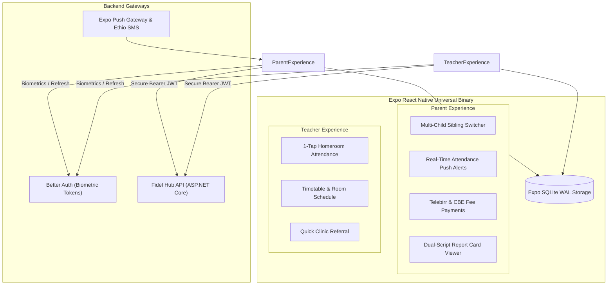

# MOBILE APPLICATION ARCHITECTURE SPECIFICATION

## Fidel Hub — Cross-Platform Mobile & Tablet Apps (Parents & Teachers)

| Document Information | Details |
| :--- | :--- |
| **Document ID** | MOB-001 |
| **Version** | 1.0 |
| **Status** | Approved Baseline |
| **Framework** | React Native (Expo SDK 52+) |
| **Target Platforms** | iOS, Android, and Android/iPad Tablets |
| **Offline Persistence**| Expo SQLite (WAL Mode) + React Native MMKV |

---

## 1. Mobile Topology & Target Audiences

The Fidel Hub mobile suite delivers dedicated, role-tailored workflows for the two most mobile user cohorts in the school ecosystem: **Parents / Guardians** and **Classroom Teachers**:



---

## 2. Parent Mobile Portal Experience

### 2.1 Multi-Child Sibling Switcher
Parents with multiple children enrolled in Fidel Hub schools switch between children with a single swipe at the top of the screen. All grades, attendance stats, and fee statements dynamically re-bind to the active child context.

### 2.2 Instant Attendance & Truancy Push Alerts
* Within 15 minutes of a homeroom teacher submitting morning attendance, parents of absent students receive a high-priority push notification and SMS alert.
* Parents can submit an excused absence explanation directly from the app (attaching doctor's note or reason).

### 2.3 Mobile Fee Settlement (Telebirr & CBE Birr)
* View term tuition balances and breakdown of line items.
* Deep-links directly into the **Telebirr** or **CBE Birr** mobile banking apps with pre-filled school merchant codes and exact Birr amounts.
* Instant digital payment receipt generated and saved to the mobile device.

### 2.4 High-Fidelity Dual-Script Report Cards
* Renders term report cards with Amharic Ge'ez script and English typography.
* Integrated verification QR code allows parents to export and verify authentic grade certificates.

---

## 3. Teacher Classroom Companion Experience

### 3.1 1-Tap Attendance Taking
* Optimized for mobile phones and classroom tablets.
* Defaults all enrolled students to "Present"; teachers swipe left on absent students and toggle "Unexcused" or "Late".
* Operates offline if school Wi-Fi is temporarily interrupted; sessions queue in Expo SQLite and sync automatically upon reconnection.

### 3.2 Daily Schedule & Lesson Tracking
* Displays the teacher's current daily period schedule, classroom numbers, and active curriculum syllabus targets.

### 3.3 Student Clinic Emergency Referral
* If a student falls ill during class, the teacher selects the student and clicks "Refer to Clinic", alerting the school nurse before the student arrives at the dispensary.

---

## 4. Local Persistence & Offline Sync Engine

```typescript
import * as SQLite from 'expo-sqlite';

export const initLocalMobileDb = async () => {
  const db = await SQLite.openDatabaseAsync('fidel_mobile.db');
  
  await db.execAsync(`
    PRAGMA journal_mode = WAL;
    PRAGMA synchronous = NORMAL;

    CREATE TABLE IF NOT EXISTS cached_students (
      id TEXT PRIMARY KEY,
      admission_number TEXT NOT NULL,
      full_name TEXT NOT NULL,
      gender TEXT NOT NULL,
      grade_level TEXT NOT NULL,
      section_name TEXT NOT NULL
    );

    CREATE TABLE IF NOT EXISTS pending_attendance_sessions (
      id TEXT PRIMARY KEY,
      section_id TEXT NOT NULL,
      date TEXT NOT NULL,
      roster_json TEXT NOT NULL,
      sync_status TEXT DEFAULT 'PENDING'
    );
  `);
  
  return db;
};
```

---

## 5. Security & Biometric Authentication

* **Hardware-Backed Key Storage**: Auth tokens and refresh credentials are stored in iOS Keychain and Android Keystore via `expo-secure-store`.
* **Biometric Lock**: FaceID / TouchID / Fingerprint unlock via `expo-local-authentication` prevents unauthorized access if a child plays with a parent's phone.
