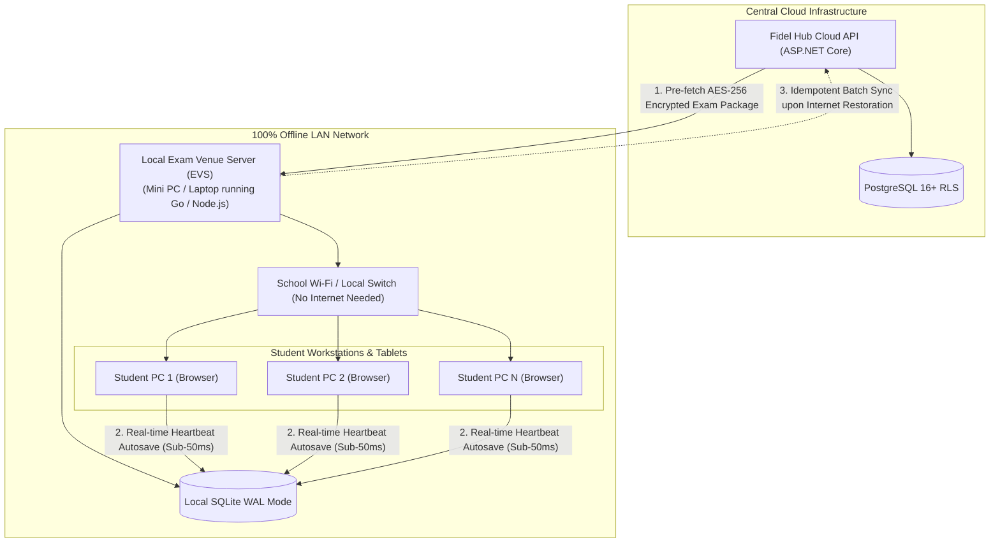

# OFFLINE CBT & LOCAL EXAM VENUE SYNCHRONIZATION SPECIFICATION

## Fidel Hub — Zero-Downtime Offline Examination Engine

| Document Information | Details |
| :--- | :--- |
| **Document ID** | OFS-001 |
| **Version** | 1.0 |
| **Status** | Approved Baseline |
| **Core Engine** | Local Exam Venue Server (EVS) + SQLite Write-Ahead Logging (WAL) |
| **Encryption Standard**| AES-256-GCM Package Encryption + SHA-256 Integrity Verification |
| **Synchronization Model**| Idempotent Batch Upload with Unique Collision Deduplication |

---

## 1. The Offline CBT Challenge & Operational Imperative

In Ethiopian K–12 schools, power fluctuations and total internet blackouts are common occurrences during national or term examinations. Halting an examination when internet connectivity drops is unacceptable.

Fidel Hub’s **Local Exam Venue Server (EVS)** guarantees that:
1. **100% Zero-Internet Test Delivery**: Once an exam package is downloaded to the school's Local Venue Server, the entire examination executes across the local school Wi-Fi or Ethernet LAN with zero dependency on the external internet.
2. **Instant Crash Recovery**: If a student workstation loses power or the browser crashes, powering it back on restores the session with **zero lost answers and exact remaining countdown time**.
3. **Zero Data Duplication on Reconnection**: When internet connectivity resumes, replayed synchronization packets use idempotent database constraints to guarantee zero score skew or duplicate answer records.

---

## 2. System Architecture & Topology



---

## 3. End-to-End Operational Lifecycle

### Stage 1: Exam Package Compilation & Encrypted Pre-Fetch
24 to 48 hours prior to examination day, the school Exam Coordinator compiles the exam paper in the Fidel Hub Cloud Portal:
1. Central API packages questions, options, KaTeX math strings, and diagrams into a compressed JSON bundle.
2. The package is encrypted using **AES-256-GCM** with a master key derived from the tenant secret and exam schedule token:
   $$\text{Package Hash} = \text{SHA-256}(\text{EncryptedPayload})$$
3. The Local Venue Server pre-fetches the package via `GET /api/v1/examinations/papers/{id}/package`.
4. The Local Venue Server validates the SHA-256 checksum. If corrupted, the package is rejected.
5. **Time-Locked Invariant**: The package remains encrypted on the local server's disk until the scheduled start time (`exam_start_at`).

### Stage 2: Time-Locked Decryption & LAN Initialization
1. At official exam time (e.g. 09:00 AM EAT), the Exam Coordinator enters their 2FA authorization PIN on the Local Venue Server dashboard.
2. The package decrypts in-memory into the local **SQLite database configured in Write-Ahead Logging (`WAL`) mode**.
3. Student candidates log in over the local LAN (`http://192.168.1.50:4000`) using their unique Admission Number and Exam PIN.

### Stage 3: Continuous Autosave & Crash Recovery
Every student action (selecting an option, typing a formula, or clicking "Next") triggers an instant asynchronous SQLite write:
```sql
-- Executed inside Local SQLite on every click
INSERT INTO local_student_answers (session_id, question_id, selected_option_id, text_response, elapsed_seconds, updated_at)
VALUES (?1, ?2, ?3, ?4, ?5, CURRENT_TIMESTAMP)
ON CONFLICT(session_id, question_id) DO UPDATE SET
    selected_option_id = excluded.selected_option_id,
    text_response = excluded.text_response,
    elapsed_seconds = excluded.elapsed_seconds,
    updated_at = CURRENT_TIMESTAMP;
```

#### Crash Recovery Walkthrough:
* **Scenario**: Student Dawit is 34 minutes into a 60-minute Biology exam when his workstation suffers a power surge.
* **Recovery**: The proctor moves Dawit to spare PC #14. Dawit enters his Admission Number and PIN.
* **State Restoration**: The Local Venue Server retrieves Dawit's active session from SQLite, restoring his 24 answered questions and setting his countdown timer to exactly 26 minutes remaining.

### Stage 4: Time-Locked Cut-off & Session Finalization
1. When the countdown timer reaches `00:00`, the workstation UI immediately freezes inputs.
2. The session record is marked `is_final = 1` and `submitted_at = datetime('now')`.
3. The candidate workstation generates a digital receipt hash verifying their submitted answers.

### Stage 5: Idempotent Batch Synchronization to Cloud
When school internet connectivity resumes post-exam:
1. The Local Venue Server initiates an automated batch upload to `POST /api/v1/cbt/sessions/sync`.
2. The request carries a unique `batch_token` UUID and client cryptographic signatures.
3. The Central Cloud PostgreSQL engine applies the batch within a transaction using PostgreSQL upserts:
   ```sql
   INSERT INTO examinations.student_answers (id, tenant_id, session_id, question_id, selected_option_id, text_response, points_awarded)
   VALUES (@id, @tenantId, @sessionId, @questionId, @selectedOptionId, @textResponse, @pointsAwarded)
   ON CONFLICT (session_id, question_id) DO NOTHING;
   ```
4. Even if network timeouts cause the Local Venue Server to re-transmit the sync batch 5 times, **zero duplicate answers are created, and student marks remain 100% consistent**.

---

## 4. Local SQLite Schema Definition (`local_exam.db`)

```sql
PRAGMA journal_mode = WAL;
PRAGMA synchronous = NORMAL;
PRAGMA foreign_keys = ON;

CREATE TABLE local_exam_papers (
    id TEXT PRIMARY KEY,
    title TEXT NOT NULL,
    duration_minutes INTEGER NOT NULL,
    total_marks REAL NOT NULL,
    instructions TEXT
);

CREATE TABLE local_questions (
    id TEXT PRIMARY KEY,
    exam_paper_id TEXT NOT NULL,
    question_text TEXT NOT NULL,
    question_type TEXT NOT NULL,
    points REAL NOT NULL,
    media_url TEXT,
    sort_order INTEGER NOT NULL,
    FOREIGN KEY (exam_paper_id) REFERENCES local_exam_papers(id)
);

CREATE TABLE local_options (
    id TEXT PRIMARY KEY,
    question_id TEXT NOT NULL,
    option_text TEXT NOT NULL,
    is_correct INTEGER NOT NULL,
    sort_order INTEGER NOT NULL,
    FOREIGN KEY (question_id) REFERENCES local_questions(id)
);

CREATE TABLE local_exam_sessions (
    id TEXT PRIMARY KEY,
    student_id TEXT NOT NULL,
    admission_number TEXT NOT NULL,
    student_name TEXT NOT NULL,
    started_at TEXT NOT NULL,
    submitted_at TEXT,
    elapsed_seconds INTEGER NOT NULL DEFAULT 0,
    is_final INTEGER NOT NULL DEFAULT 0,
    sync_status TEXT NOT NULL DEFAULT 'PENDING' -- PENDING, SYNCED, FAILED
);

CREATE TABLE local_student_answers (
    session_id TEXT NOT NULL,
    question_id TEXT NOT NULL,
    selected_option_id TEXT,
    text_response TEXT,
    elapsed_seconds INTEGER NOT NULL,
    updated_at TEXT NOT NULL,
    PRIMARY KEY (session_id, question_id),
    FOREIGN KEY (session_id) REFERENCES local_exam_sessions(id)
);
```

---

## 5. Hardware Specifications for Local Venue Server

| Component | Minimum Specification | Recommended Specification (500+ Students) |
| :--- | :--- | :--- |
| **Device Type** | Any standard laptop / Mini PC | Dedicated Intel NUC or Rack Server |
| **CPU** | Intel Core i3 / AMD Ryzen 3 (4 Cores) | Intel Core i5 / AMD Ryzen 5 (8 Cores) |
| **RAM** | 8 GB DDR4 | 16 GB DDR4/DDR5 |
| **Storage** | 128 GB SSD (NVMe preferred for high IOPS) | 256 GB NVMe SSD |
| **Networking** | Gigabit Ethernet (1000BASE-T) | Gigabit Ethernet + Dedicated Wi-Fi 6 APs |
| **Power Backup** | Laptop Battery or 650VA UPS | 1500VA Online UPS |
| **Operating System** | Ubuntu 22.04 LTS / Windows 11 Pro | Ubuntu 24.04 LTS Server |

---

## 6. Implementation with Drizzle ORM, Zod & Sentry

### 6.1 Drizzle ORM & better-sqlite3 in Local Venue Server
The Local Exam Venue Server runtime uses Node.js / TypeScript with **Drizzle ORM** and `better-sqlite3` in WAL mode. This guarantees type-safe database queries with sub-millisecond execution times:

`	ypescript
import Database from 'better-sqlite3';
import { drizzle } from 'drizzle-orm/better-sqlite3';
import { sqliteTable, text, integer, real } from 'drizzle-orm/sqlite-core';

const sqlite = new Database('local_exam.db');
sqlite.pragma('journal_mode = WAL');
sqlite.pragma('synchronous = NORMAL');

export const db = drizzle(sqlite);

export const localStudentAnswers = sqliteTable('local_student_answers', {
  sessionId: text('session_id').notNull(),
  questionId: text('question_id').notNull(),
  selectedOptionId: text('selected_option_id'),
  textResponse: text('text_response'),
  elapsedSeconds: integer('elapsed_seconds').notNull(),
  updatedAt: text('updated_at').notNull(),
});
`

### 6.2 Inbound Payload Validation with Zod
Before the Local Venue Server stores or syncs answers, payloads are validated via a strict **Zod** contract:

`	ypescript
import { z } from 'zod';

export const SyncBatchPayloadSchema = z.object({
  batchToken: z.string().uuid(),
  venueServerId: z.string().min(3),
  examPaperId: z.string().uuid(),
  sessions: z.array(z.object({
    sessionId: z.string().uuid(),
    studentId: z.string().uuid(),
    isFinal: z.boolean(),
    elapsedSeconds: z.number().int().nonnegative(),
    answers: z.array(z.object({
      questionId: z.string().uuid(),
      selectedOptionId: z.string().uuid().nullable().optional(),
      textResponse: z.string().nullable().optional(),
    }))
  }))
});
`

### 6.3 Sentry Real-Time Crash Monitoring
During live assessments, student workstations report unexpected errors to Sentry tagged with `venue_server_id` and `exam_paper_id`. If an unhandled client error occurs, Sentry alerts proctors immediately while local SQLite WAL ensures no student keystrokes are lost.