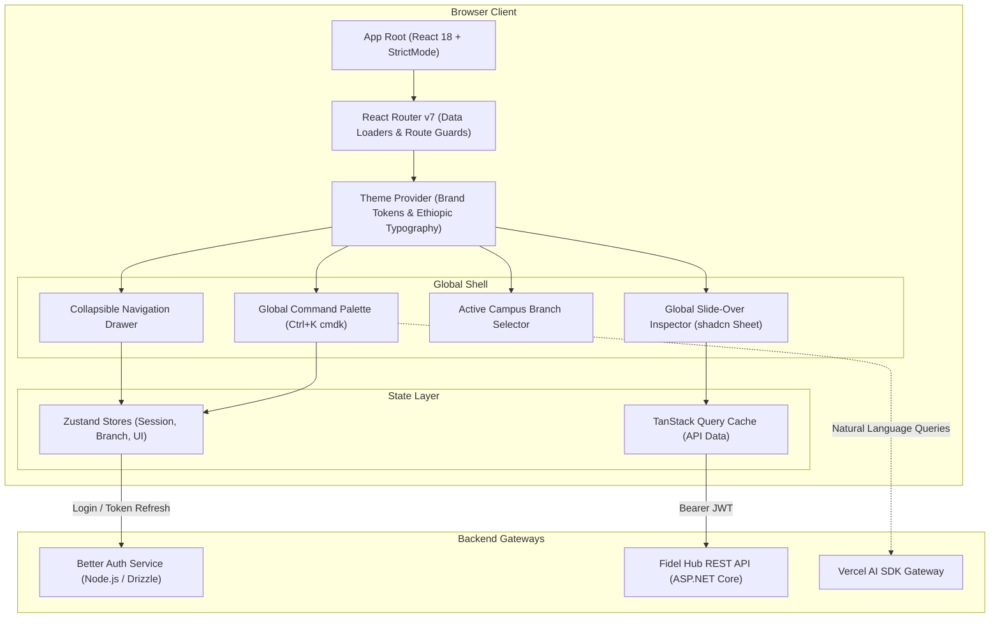

# WEB APPLICATION ARCHITECTURE SPECIFICATION

## Fidel Hub — Enterprise React Web Administration Portal

| Document Information | Details |
| :--- | :--- |
| **Document ID** | WEB-001 |
| **Version** | 1.1 (Updated with Approved Ecosystem Libraries) |
| **Status** | Approved Baseline |
| **Core Tech Stack** | React 18 + Vite 5 + TypeScript 5 |
| **UI Components** | Material UI (MUI v6) Theme Tokens (fidelTheme palette) + shadcn/ui & Radix UI Primitives |
| **Iconography** | Tabler Icons (`@tabler/icons-react`) |
| **Form Validation** | Zod (`zod`) + React Hook Form (`react-hook-form`) |
| **Utilities & Dates** | Day.js (`dayjs`) + Lodash-es (`lodash-es`) |
| **Command Palette** | cmdk (`cmdk`) |
| **AI Workflows** | Vercel AI SDK (`ai`) |
| **State Architecture**| TanStack Query v5 (`@tanstack/react-query`) + Zustand (`zustand`) |
| **Application Telemetry**| Sentry (`@sentry/react`) |
| **Hosting & Edge CDN**| Vercel Global Edge Network |

---

## 1. Frontend Architecture & Enterprise UX Patterns

The Fidel Hub Web Portal is designed for school administrators, principals, cashiers, and teachers managing large academic cohorts. It prioritizes **high information density, rapid keyboard navigation, and instant data retrieval**:



---

## 2. Design System & Brand Identity Tokens

The interface implements Fidel Hub's verified brand palette via Material UI (MUI v6) theme tokens (`fidelTheme`). Components must **never hardcode raw color hex strings**, instead referencing theme tokens (`theme.palette.*`) or CSS variables:

| Token Name | Hex Code | Role in Application |
| :--- | :--- | :--- |
| `primary.main` | `#1B5E3F` | Deep Forest Green — Primary app bars, buttons, brand accent |
| `secondary.main`| `#E0A526` | Warm Gold — Badges, financial indicators, action highlights |
| `background.default`| `#FAF7F0`| Off-White / Parchment — High-legibility paper canvas background |
| `text.primary` | `#1F2933` | Dark Slate Ink — High-contrast typography |
| `success.main` | `#2E7D32` | Paid invoices, present attendance, passing exam marks |
| `error.main` | `#D32F2F` | Unexcused absences, overdue fees, severe clinic visits |

### Bilingual Typography Configuration:
* **Latin Script (English)**: Inter / Public Sans font families for numbers, codes, and interface labels.
* **Ge'ez Script (Amharic ፊ)**: `Noto Sans Ethiopic` for dual-script report cards, student patronymics, and national announcements.

---

## 3. Signature Enterprise Features & Approved Ecosystem Libraries

### 3.1 Global Command Palette (`Ctrl+K` with `cmdk` & Vercel AI SDK)
* Instant global search accessible anywhere via keyboard shortcut `Ctrl+K`.
* **Direct Navigation**: Fast switching by admission number (`FHA-2026-0042`), student names, or quick shortcuts (`"Take Attendance"`, `"Record Payment"`, `"Generate Report Cards"`).
* **AI-Assisted Natural Language Queries**: Powered by the Vercel AI SDK, allowing administrators to query: *"Show all unexcused absences for Grade 9 today"* or *"Which students owe more than 2,000 ETB?"*.

### 3.2 Slide-Over Detail Sheets (`shadcn/ui Sheet`)
* Detail records (Student 360° profile, Clinic visit intake, Book loan checkout) open in non-intrusive 480px slide-over sheets from the right viewport edge.
* Users inspect student biodata, attendance history, and fee balances without losing context or navigating away from their active data table.

### 3.3 High-Density Virtualized Data Tables
* Virtualized data grids supporting 2,000+ student marksheet entries without frame drops.
* Sticky headers, inline keyboard navigation (`Tab` and `Enter` to cycle mark inputs), and 1-click Excel/CSV export.

### 3.4 Dual-Calendar Ethiopian / Gregorian Date Picker
* Interactive UI component allowing users to toggle between:
  - **Ethiopian Calendar (EC)**: 13 months (Meskerem to Pagume) with native year calculations.
  - **Gregorian Calendar (GC)**: Standard international date selection.
* `Day.js` ensures lightweight date parsing and relative timestamps (*"absent 15 min ago"*, *"due in 3 days"*).

### 3.5 Client Form Validation with Zod & React Hook Form
* Every user mutation form (Student Admissions, Fee Payment, Exam Question Authoring) is guarded by a strictly typed **Zod schema** with automatic TypeScript type inference.

### 3.6 Iconography with Tabler Icons (`@tabler/icons-react`)
* Unified vector icon set across all 15 functional modules: `IconSchool`, `IconCalendar`, `IconReceipt`, `IconDeviceLaptop`, `IconBook`, `IconFlask`, `IconFirstAidKit`, `IconShieldCheck`.

---

## 4. State Management Architecture

```mermaid
graph LR
    subgraph Client UI State (Zustand)
        Z1["useAuthStore: User token, roles, permissions"]
        Z2["useBranchStore: Active branchId, campus list"]
        Z3["useUIStore: Command bar open, slide-over drawer state"]
    end

    subgraph Server Cache State (TanStack Query)
        Q1["Students Directory Query (StaleTime: 5 min)"]
        Q2["Active Timetable Query (StaleTime: 15 min)"]
        Q3["Fee Structures Query (StaleTime: 1 hour)"]
        Q4["Clinic Dispensary Roster (StaleTime: 30 sec)"]
    end
```

### Optimistic UI Mutations:
When a teacher submits an attendance mark or a librarian processes a book return, TanStack Query immediately applies the change optimistically to the local cache, delivering **sub-16ms instantaneous user feedback** while synchronizing in the background.

---

## 5. Security & Role-Based Route Guards

```tsx
// Route protection component
export const RequirePermission = ({ permission, children }: { permission: string; children: React.ReactNode }) => {
  const { hasPermission } = useAuthStore();
  
  if (!hasPermission(permission)) {
    return <Navigate to="/unauthorized" replace />;
  }
  
  return <>{children}</>;
};

// Route definitions with capability policies
<Route path="/library/loans" element={
  <RequirePermission permission="lib.loan.checkout">
    <LibraryCirculationDeskPage />
  </RequirePermission>
} />
```

---

## 6. Cloud Deployment on Vercel Edge CDN

The web application is compiled via Vite and deployed directly to **Vercel**:
* **Global Edge CDN**: Static HTML, CSS, JavaScript, and font assets are cached at edge points of presence across Africa and Europe for sub-second initial load times.
* **Preview Branches**: Every pull request generates an automated preview deployment for QA and stakeholder review.
* **Headers & Security**: Automated HTTP security headers (`Content-Security-Policy`, `X-Frame-Options: DENY`, `Strict-Transport-Security`).
