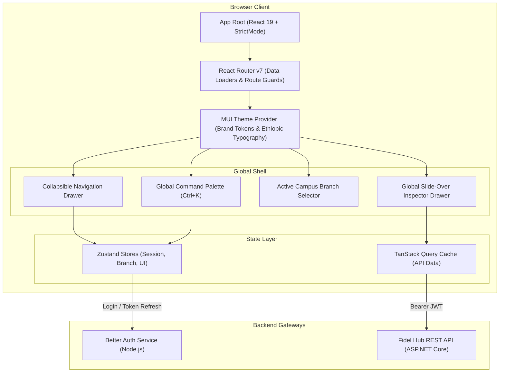

# WEB APPLICATION ARCHITECTURE SPECIFICATION

## Fidel Hub — Enterprise React Web Administration Portal

| Document Information | Details |
| :--- | :--- |
| **Document ID** | WEB-001 |
| **Version** | 1.0 |
| **Status** | Approved Baseline |
| **Tech Stack** | React 19 + Vite 6 + TypeScript 5 + Material UI (MUI v6) |
| **Design Language**| Enterprise Density, Forest Green Brand Tokens, Command Palette (`Ctrl+K`) |
| **State Architecture**| TanStack Query v5 (Server State) + Zustand (Client UI State) |

---

## 1. Frontend Architecture & Enterprise UX Patterns

The Fidel Hub Web Portal is designed for school administrators, principals, cashiers, and teachers managing large academic cohorts. It prioritizes **high information density, rapid keyboard navigation, and instant data retrieval**:



---

## 2. Design System & Brand Identity Tokens

The interface implements Fidel Hub's verified brand palette:

| Token Name | Hex Code | Role in Application |
| :--- | :--- | :--- |
| `primary.main` | `#1B5E3F` | Deep Forest Green — Primary app bars, buttons, brand accent |
| `secondary.main`| `#E0A526` | Warm Gold — Badges, financial indicators, action highlights |
| `background.default`| `#FAF7F0`| Off-White / Parchment — High-legibility paper canvas background |
| `text.primary` | `#1F2933` | Dark Slate Ink — High-contrast typography |
| `success.main` | `#2E7D32` | Paid invoices, present attendance, passing exam marks |
| `error.main` | `#D32F2F` | Unexcused absences, overdue fees, severe clinic visits |

### Bilingual Typography Configuration:
* **Latin Script (English)**: Inter / Public Sans font families for numbers, codes, and interface labels.
* **Ge'ez Script (Amharic ፊ)**: `Noto Sans Ethiopic` for dual-script report cards, student patronymics, and national announcements.

---

## 3. Signature Enterprise Features

### 3.1 Global Command Palette (`Ctrl+K` / `Cmd+K`)
* Instant global search accessible anywhere via keyboard shortcut `Ctrl+K`.
* Allows typing student admission numbers (`FHA-2026-0042`), teacher names, or direct navigation commands (`"Take Attendance"`, `"Record Payment"`, `"Generate Report Cards"`).

### 3.2 Slide-Over Detail Sheets (Drawers)
* Detail records (Student 360° view, Clinic visit intake, Book loan checkout) open in non-intrusive 480px slide-over drawers from the right viewport edge.
* Users inspect student biodata, attendance history, and fee balances without losing context or navigating away from their active data table.

### 3.3 High-Density Spreadsheet Data Tables
* Virtualized data grids supporting 2,000+ student marksheet entries without frame drops.
* Sticky headers, inline keyboard navigation (`Tab` and `Enter` to cycle mark inputs), and 1-click Excel/CSV export.

### 3.4 Dual-Calendar Ethiopian / Gregorian Date Picker
* Interactive UI component allowing users to toggle between:
  - **Ethiopian Calendar (EC)**: 13 months (Meskerem to Pagume) with native year calculations.
  - **Gregorian Calendar (GC)**: Standard international date selection.
* Bidirectional deterministic conversion ensures the backend always receives clean Gregorian UTC dates.

---

## 4. State Management Architecture

```mermaid
graph LR
    subgraph Client UI State (Zustand)
        Z1["useAuthStore: User token, roles, permissions"]
        Z2["useBranchStore: Active branchId, campus list"]
        Z3["useUIStore: Command bar open, slide-over drawer state"]
    end

    subgraph Server Cache State (TanStack Query)
        Q1["Students Directory Query (StaleTime: 5 min)"]
        Q2["Active Timetable Query (StaleTime: 15 min)"]
        Q3["Fee Structures Query (StaleTime: 1 hour)"]
        Q4["Clinic Dispensary Roster (StaleTime: 30 sec)"]
    end
```

### Optimistic UI Mutations:
When a teacher submits an attendance mark or a librarian processes a book return, TanStack Query immediately applies the change optimistically to the local cache, delivering **sub-16ms instantaneous user feedback** while synchronizing in the background.

---

## 5. Security & Role-Based Route Guards

```tsx
// Route protection component
export const RequirePermission = ({ permission, children }: { permission: string; children: React.ReactNode }) => {
  const { hasPermission } = useAuthStore();
  
  if (!hasPermission(permission)) {
    return <Navigate to="/unauthorized" replace />;
  }
  
  return <>{children}</>;
};

// Route definitions with capability policies
<Route path="/library/loans" element={
  <RequirePermission permission="lib.loan.checkout">
    <LibraryCirculationDeskPage />
  </RequirePermission>
} />
```
