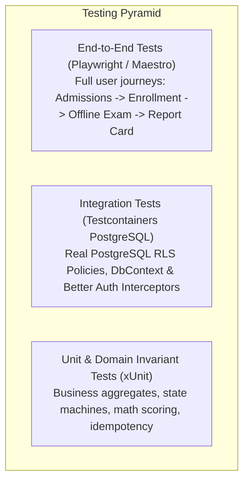

# TESTING STRATEGY SPECIFICATION

## Fidel Hub — Quality Assurance, Verification & Automated Testing Framework

| Document Information | Details |
| :--- | :--- |
| **Document ID** | TST-001 |
| **Version** | 1.0 |
| **Status** | Approved Baseline |
| **Backend Testing** | xUnit, FluentAssertions, Testcontainers.PostgreSql, WebApplicationFactory |
| **Frontend Testing** | Vitest, React Testing Library, Playwright E2E |
| **Performance Testing** | k6 Load Testing (CBT Autosave Concurrency Benchmarks) |

---

## 1. Testing Pyramid & Verification Philosophy

Fidel Hub’s mission-critical domain—handling academic credentials, offline national assessments, and financial school fees—demands rigorous automated verification across all layers:



| Test Category | Target Scope | Execution Environment | Target Frequency |
| :--- | :--- | :--- | :--- |
| **Unit Tests** | Domain aggregates, value objects, grading formulas, fee calculators | In-memory / xUnit | Every local build & PR |
| **Integration Tests**| EF Core + PostgreSQL RLS policies, Dapper queries, MediatR pipeline | Testcontainers Docker container | Pre-merge CI/CD pipeline |
| **Security Tests** | RLS tenant isolation penetration, Better Auth JWT tampering, SQLi | Automated security test runner | Nightly CI run |
| **E2E Tests** | Web portal command bar, attendance roster, parent mobile views | Headless Chromium (Playwright) | Staging deployment gate |
| **Load Tests (k6)**| 500 concurrent student autosaves/sec, 1,000 PDF report cards | Dedicated test cluster | Prior to each major release |

---

## 2. Invariant & Security Verification Suite

### 2.1 Multi-Tenant Kernel RLS Isolation Tests
To prove that tenant data can **never leak** across school boundaries, integration tests spin up a real PostgreSQL container with all 15 schemas and full RLS policies enabled:

```csharp
[Fact]
public async Task Query_WhenTenantAUserQueriesStudent_CannotSeeTenantBStudent()
{
    // Arrange
    var tenantA = Guid.NewGuid();
    var tenantB = Guid.NewGuid();

    // Insert student for Tenant B directly as DB admin
    var studentBId = await InsertStudentAsAdminAsync(tenantB, "Student B");

    // Act: Establish connection context for Tenant A
    using var connection = _fixture.CreateConnectionForTenant(tenantA);
    var students = await connection.QueryAsync<StudentDto>("SELECT * FROM students.students;");

    // Assert: Kernel RLS must return zero rows for Tenant B's student
    students.Should().NotContain(s => s.Id == studentBId);
}
```

### 2.2 Financial Idempotency & Payment Concurrency Tests
Verify that concurrent rapid payment submissions with identical `Idempotency-Key` headers never double-credit invoices:

```csharp
[Fact]
public async Task CollectPayment_ConcurrentSubmissionsWithSameIdempotencyKey_CreatesOnlyOneReceipt()
{
    var idempotencyKey = Guid.NewGuid();
    var invoiceId = await CreatePostedInvoiceAsync(4500.00m);

    var command = new CollectPaymentCommand(invoiceId, 4500.00m, "TELEBIRR", "TLB-12345", idempotencyKey);

    // Act: Fire 5 concurrent requests with the identical idempotency key
    var tasks = Enumerable.Range(0, 5).Select(_ => _client.PostPaymentAsync(command));
    var results = await Task.WhenAll(tasks);

    // Assert: All 5 calls return success, referencing the exact same receipt ID
    results.Select(r => r.ReceiptNumber).Distinct().Should().ContainSingle();
    var invoice = await GetInvoiceAsync(invoiceId);
    invoice.PaidAmount.Should().Be(4500.00m); // Never 22,500m!
}
```

### 2.3 Offline CBT Engine Crash Recovery Tests
1. **Simulation**: Launch Local Venue Server with SQLite WAL.
2. Initialize student exam session with 50 randomized questions.
3. Simulate student answering 23 questions, then abruptly terminate the workstation process (`SIGKILL`).
4. Reopen workstation session with candidate Admission Number and PIN.
5. **Assertion**: Verify exactly 23 answers restored, selected options intact, and remaining timer accurate to within 1 second.

---

## 3. k6 Performance & Load Testing Benchmarks

```javascript
import http from 'k6/http';
import { check, sleep } from 'k6';

export const options = {
  stages: [
    { duration: '30s', target: 100 }, // Warm-up
    { duration: '2m', target: 500 },  // Sustained 500 concurrent student autosaves
    { duration: '30s', target: 0 },   // Cool-down
  ],
  thresholds: {
    http_req_duration: ['p(95)<50'], // 95% of autosaves must complete in under 50ms
    http_req_failed: ['rate<0.001'], // 99.9% success rate
  },
};

export default function () {
  const payload = JSON.stringify({
    sessionId: '3fa85f64-5717-4562-b3fc-2c963f66afa6',
    questionId: '7ca85f64-5717-4562-b3fc-2c963f66afa7',
    selectedOptionId: '9ca85f64-5717-4562-b3fc-2c963f66afa8',
    elapsedSeconds: 412,
  });

  const params = {
    headers: { 'Content-Type': 'application/json' },
  };

  const res = http.post('http://localhost:4000/api/local/answers/autosave', payload, params);
  check(res, { 'status is 200': (r) => r.status === 200 });
  sleep(1);
}
```
