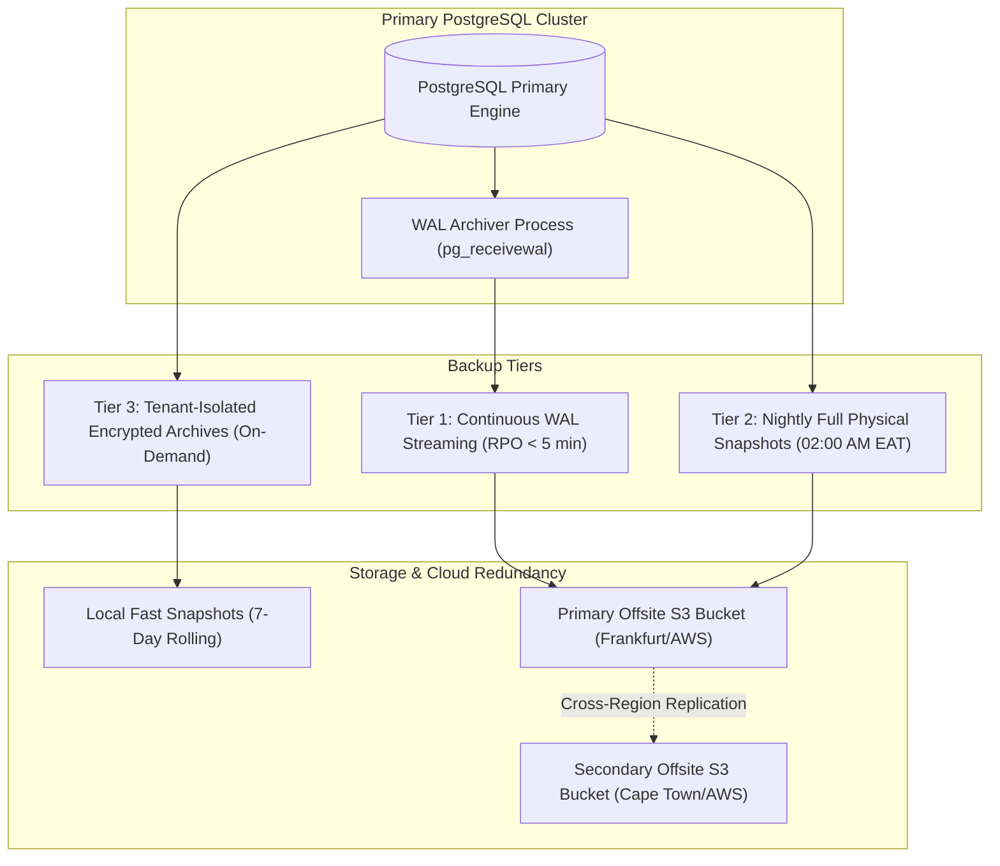

# BACKUP & DISASTER RECOVERY SPECIFICATION

## Fidel Hub — High-Availability Business Continuity & Restoration Runbook

| Document Information | Details |
| :--- | :--- |
| **Document ID** | BKR-001 |
| **Version** | 1.0 |
| **Status** | Approved Baseline |
| **Target Database** | PostgreSQL 16+ Managed Cluster |
| **Recovery Point Objective (RPO)** | **< 5 Minutes** (via Continuous WAL Streaming) |
| **Recovery Time Objective (RTO)** | **< 30 Minutes** (Automated Failover & Restoration) |

---

## 1. Multi-Tier Backup Architecture

To ensure uninterrupted school operations and guarantee academic data sovereignty, Fidel Hub maintains a **three-tier backup redundancy model**:



---

## 2. Backup Schedules & Retention Policies

| Tier | Backup Type | Frequency | Retention Window | Storage Target |
| :--- | :--- | :--- | :--- | :--- |
| **Tier 1** | WAL Logs (Continuous Archiving) | Every 60 seconds | 14 Days (Point-In-Time) | Encrypted S3 Bucket |
| **Tier 2** | Full Physical Dump (`pg_dump`) | Daily at 02:00 AM EAT | 30 Days Daily, 12 Months Monthly | Geo-Redundant S3 |
| **Tier 3** | Tenant Logical Backup (Per-School)| Weekly / Prior to Migrations | Retained indefinitely by Tenant | Tenant Download Vault |

---

## 3. Disaster Recovery Runbooks

### Runbook 1: Point-In-Time Recovery (PITR) Execution
* **Trigger**: Catastrophic database corruption or accidental batch deletion occurring at `2026-11-15 11:32:00 EAT`.
* **Execution Procedure**:
  1. Provision a clean PostgreSQL 16 instance.
  2. Restore the latest daily base snapshot preceding the event:
     ```bash
     pg_restore -h localhost -U fidel_admin -d fidel_hub_prod base_backup_20261115.dump
     ```
  3. Configure `recovery.signal` and specify the recovery target time:
     ```ini
     restore_command = 'aws s3 cp s3://fidel-hub-wal-archive/%f %p'
     recovery_target_time = '2026-11-15 11:31:00+03'
     recovery_target_action = 'promote'
     ```
  4. Start PostgreSQL. The engine replays WAL logs up to 11:31:00 AM and promotes the database cleanly.
  5. Validate data integrity and point PgBouncer to the recovered instance.

### Runbook 2: Primary Node Hardware Failure (Automated Failover)
* **Trigger**: Primary database engine unresponsiveness for > 30 seconds.
* **Execution Procedure**:
  1. High-availability orchestrator detects primary node failure.
  2. Secondary standby replica is promoted to primary (`pg_ctl promote`).
  3. PgBouncer rewrites its upstream target host configuration and issues `RELOAD`.
  4. Application pods resume database traffic within 45 seconds with zero manual code re-deployment.

### Runbook 3: Single School Tenant Data Restoration
* **Trigger**: A school accidentally withdraws an entire grade level or requests a roll-back of custom timetables.
* **Execution Procedure**:
  1. Restore the historical backup into an isolated staging database.
  2. Extract the target tenant's schema records using RLS filtering:
     ```sql
     SET LOCAL app.current_tenant_id = 'target-tenant-uuid';
     COPY (SELECT * FROM students.students) TO '/tmp/tenant_students.csv';
     ```
  3. Ingest the restored records back into the production cluster within a tenant transaction block without touching other schools' data.

---

## 4. Automated Backup Verification & Drill Schedule

1. **Daily Automated Validation**: Every morning at 04:00 AM EAT, a background runner spins up an ephemeral Docker container, restores the previous night’s backup, and executes an automated integrity test suite.
2. **Bi-Annual Full Disaster Simulation**: The engineering team executes a live fire drill failing over production traffic to a secondary region.
