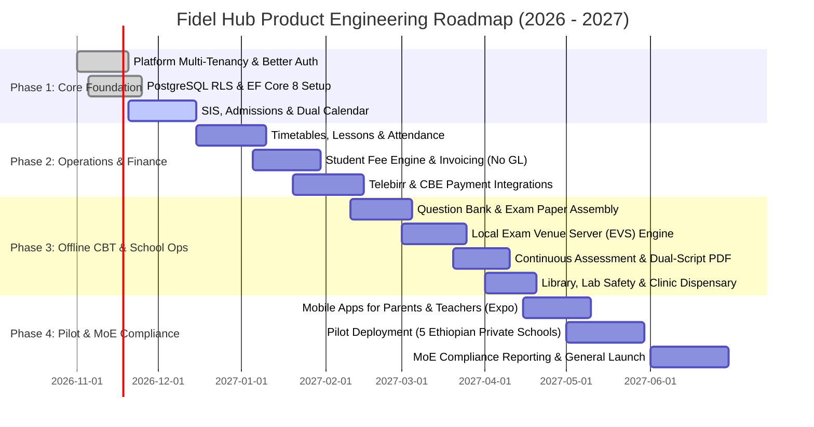

# DEVELOPMENT ROADMAP SPECIFICATION

## Fidel Hub — Product Milestones, Strategic Horizons & Release Schedule

| Document Information | Details |
| :--- | :--- |
| **Document ID** | RDM-001 |
| **Version** | 1.0 |
| **Status** | Approved Baseline |
| **Execution Window** | November 2026 – June 2027 (Academic Year Rollout) |
| **Delivery Strategy** | Phased Milestone Rollout with Dual-Track Beta Pilot |

---

## 1. Multi-Phase Roadmap Horizons

---

## 2. Phase Breakdown & Acceptance Milestones

### Phase 1: Institutional Foundation & Identity (Weeks 1–6)
* Multi-tenant organization provisioning and branch campus management.
* Dedicated Better Auth service integration (Organizations & JWT plugins).
* Native PostgreSQL Row-Level Security (RLS) enforcement across 15 schemas.
* Student Information System (SIS) with three-part Ethiopian names and online admissions intake.
* Dual Calendar Engine supporting both Ethiopian Calendar (EC) and Gregorian Calendar (GC).

### Phase 2: Daily Operations, Attendance & Fee Billing (Weeks 7–12)
* Conflict-free classroom timetable builder and weekly teacher lesson plan submission.
* 1-Click morning homeroom attendance and rapid period attendance.
* Automated unexcused absence SMS alerts via Ethio Telecom / Telebirr gateway within 15 minutes.
* High-integrity Student Fee Engine: fee structures, snapshot agreements, batch invoice generation, and idempotent payment receipting (telebirr, CBE, cash).

### Phase 3: Offline CBT Engine, Gradebooks & Auxiliary Facilities (Weeks 13–18)
* Rich Question Bank with KaTeX mathematical formulas and difficulty metadata.
* Local Exam Venue Server (EVS) engine supporting **100% offline LAN test delivery with SQLite WAL autosave**.
* Spreadsheet-style continuous assessment marksheet and term gradebook lock enforcement.
* Batch compilation of dual-script PDF report cards featuring Ge'ez Amharic typography and verification QR codes.
* Practical auxiliary modules (Phase 2 / P2 Expanded): Library circulation (Module 11), Lab safety booking (Module 12), Student clinic dispensary (Module 13), and Teacher mark audit logs (Module 14).

### Phase 4: Mobile Ecosystem, Pilot Launch & National Bureau Exports (Weeks 19–24)
* React Native (Expo) apps for Parents (attendance alerts, fee payment, report cards) and Teachers (attendance companion).
* Pilot deployment across 5 premier partner schools in Addis Ababa and regional hubs.
* Ministry of Education compliance exports and enterprise SaaS subscription billing & quota enforcement (Platform SuperAdmin Module 15).
