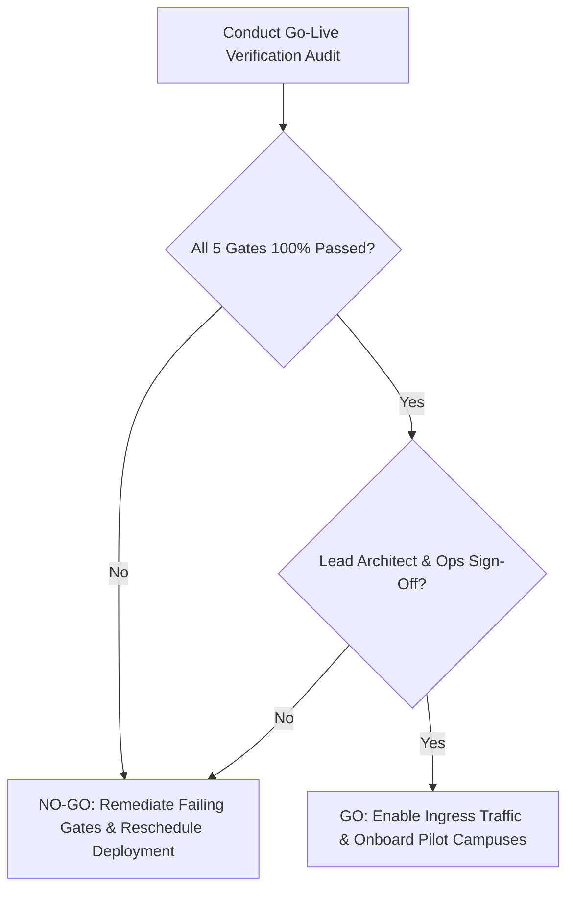

# PRODUCTION GO-LIVE CHECKLIST

## Fidel Hub — Pre-Flight Production Verification & Go/No-Go Decision Protocol

| Document Information | Details |
| :--- | :--- |
| **Document ID** | PCL-001 |
| **Version** | 1.0 |
| **Status** | Approved Baseline |
| **Sign-Off Authority** | Lead Software Architect & Technical Operations Lead |
| **Runtime Baseline** | .NET 8 LTS (`net8.0`) |
| **Prerequisites** | Developers must install .NET 8 LTS SDK or higher. |
| **Container Directives** | `mcr.microsoft.com/dotnet/aspnet:10.0` |

---

## 1. Pre-Flight Verification Gates

Before directing live institutional traffic or executing student assessments on Fidel Hub, every item in this checklist must be rigorously verified and signed off:

### 1. Security & Kernel Multi-Tenancy Isolation
- [ ] **RLS Enforcement**: Every tenant-owned table in all 15 schemas has `ROW LEVEL SECURITY` enabled and forced (`FORCE ROW LEVEL SECURITY`).
- [ ] **Unprivileged Role**: The application connects using `fidel_app_user` which strictly possesses `NOSUPERUSER` and `NOBYPASSRLS`.
- [ ] **Better Auth Security**: Better Auth secret is a high-entropy 256-bit cryptographically random key; JWKS endpoint is cached with automated rotation.
- [ ] **Cross-Tenant Attack Suite**: Automated RLS penetration tests (SEC-RLS-01 through SEC-RLS-06) pass with 100% zero data leakage.
- [ ] **TLS 1.3 Strict**: All HTTP endpoints enforce TLS 1.3 with HSTS (`Strict-Transport-Security: max-age=31536000; includeSubDomains`).

### 2. Database Topology & Performance
- [ ] **Connection Pooler**: PgBouncer is verified operating in **Transaction Pooling Mode** (`pool_mode = transaction`).
- [ ] **Session Variable Injection**: Connection interceptor reliably executes `SET LOCAL app.current_tenant_id` at the start of every transaction.
- [ ] **WAL Archiving**: Continuous WAL streaming to offsite S3 storage is confirmed active with RPO < 5 minutes.
- [ ] **Point-in-Time Recovery**: Automated restoration drill successfully verified against a fresh ephemeral database.
- [ ] **Index Verification**: All foreign keys and tenant compound indexes are verified in production PostgreSQL catalog.

### 3. Financial Integrity & Invoicing
- [ ] **Invoice Immutability Trigger**: The `trg_posted_invoice_immutable` trigger is active; attempting to modify a `POSTED` invoice row throws an exception.
- [ ] **Idempotency Constraint**: Unique constraint `uq_payments_idempotency` on `finance.payments` is verified.
- [ ] **Payment Channels Tested**: Telebirr, CBE Birr, and Cashier receipt generation tested with production merchant sandbox credentials.
- [ ] **Sequential Receipts**: Branch receipt generator tested under concurrent threads, verifying zero duplicate receipt numbers.

### 4. Offline CBT & Local Exam Venue Server
- [ ] **Package Encryption**: Exam package export confirms AES-256-GCM encryption with SHA-256 integrity hash.
- [ ] **Zero-Internet Execution**: Local Exam Venue Server (EVS) verified running 500 concurrent student sessions on an air-gapped local Wi-Fi switch.
- [ ] **Crash Recovery Drill**: Simulated workstation crash during active exam confirms 100% answer retention and exact timer recovery.
- [ ] **Idempotent Batch Sync**: Replayed batch upload confirms zero duplicate rows (`ON CONFLICT DO NOTHING`).

### 5. Application Monitoring & Observability
- [ ] **Health Probes**: `/health/live` and `/health/ready` endpoints respond with accurate dependency status.
- [ ] **Transactional Outbox Worker**: Background processor confirms steady polling and zero message backlog.
- [ ] **SMS Gateway Quotas**: Ethio Telecom bulk SMS balance verified and alert thresholds configured.
- [ ] **Error Tracking**: Centralized logging and real-time alerts configured for 5xx error spikes.

---

## 2. Go/No-Go Decision Protocol

| Decision | Criteria | Action Plan |
| :--- | :--- | :--- |
| **GO** | 100% of checklist items verified green; zero open severity 1 or 2 defects. | Open public DNS routing; initiate pilot onboarding. |
| **NO-GO** | Any single security, financial, or data isolation gate failing. | Abort go-live; maintain previous stable deployment. |
