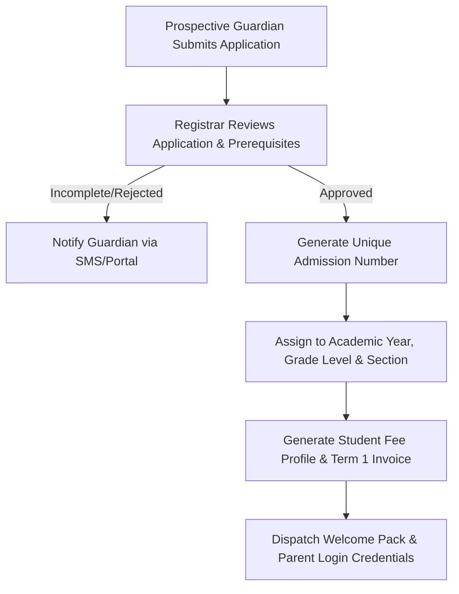
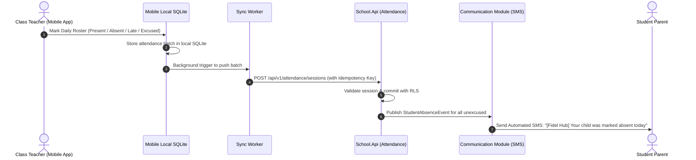
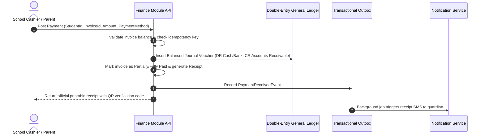
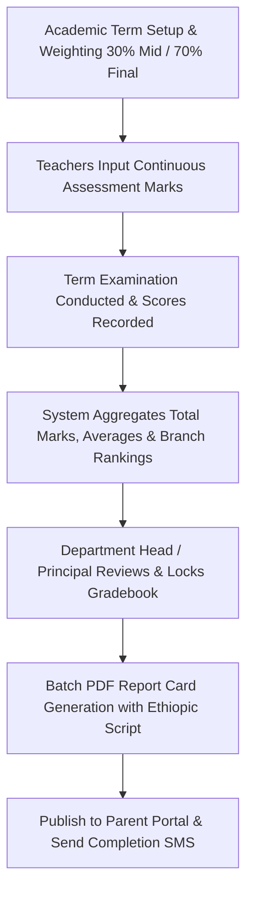

# BUSINESS WORKFLOWS & OPERATIONAL SPECIFICATIONS

## Fidel Hub — Standard Operating Workflows

| Document Information | Details |
| :--- | :--- |
| **Document** | Business Workflows Specification |
| **Version** | 1.0-DRAFT |
| **Status** | Template / Baseline |
| **Market** | Ethiopian K–12 Schools |

---

## 1. Student Admission & Enrollment Workflow

### Steps:
1. **Intake**: Guardian provides student biodata, national ID / birth certificate, and previous school transfer transcripts.
2. **Review & Screening**: Admissions committee checks age eligibility and class capacity.
3. **Provisioning**: System allocates tenant-scoped admission number (e.g., `SJA-2026-0042`).
4. **Billing Activation**: Initial registration and tuition fee invoice generated automatically.

---

## 2. Daily Attendance & Absence Escalation Workflow

---

## 3. Fee Billing, Payment & Double-Entry Ledger Workflow

### Business Rules:
- Under no circumstances can a posted transaction be modified or deleted.
- Cancellations must be performed through an authorized `Credit Note` or `Reversal Journal Entry`.
- Partial payments are supported; outstanding balances carry forward into subsequent billing statements.

---

## 4. Examination, Continuous Assessment & Report Card Generation

