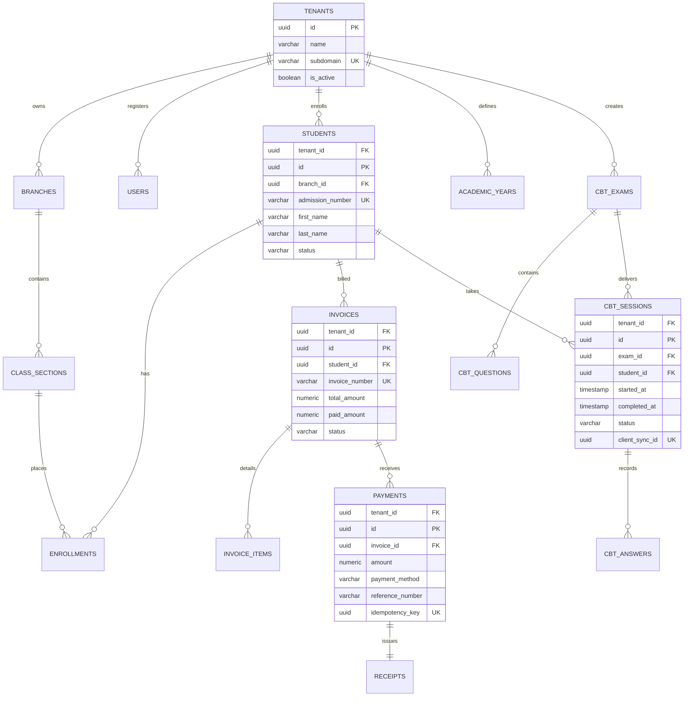

# ENTITY RELATIONSHIP DIAGRAM (ERD)

## Fidel Hub — Relational Schema Models

| Document Information | Details |
| :--- | :--- |
| **Document** | Entity Relationship Diagram |
| **Version** | 2.0-ALIGNED |
| **Scope** | Core Multi-Tenant School Operations, Fees & CBT Examinations |

---

## 1. High-Level Core ERD

