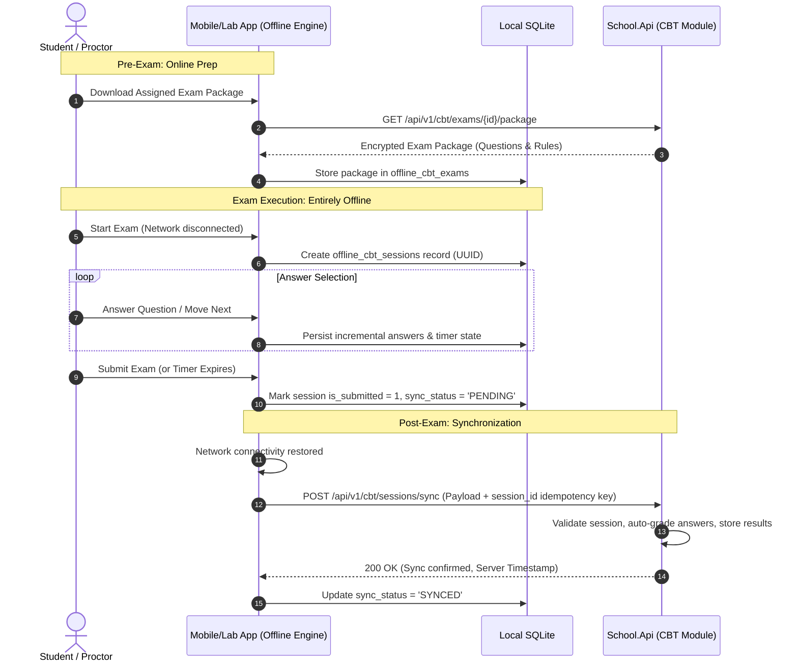

# OFFLINE SYNCHRONIZATION SPECIFICATION: CBT & EXAMINATIONS

## Fidel Hub — Offline-First Exam Taking & Synchronization Protocol

| Document Information | Details |
| :--- | :--- |
| **Document** | Offline Synchronization Specification |
| **Version** | 2.0-ALIGNED |
| **Primary Domain** | CBT (Computer-Based Testing) & Student Assessments |

---

## 1. Context & Motivation
In accordance with the PRD and school infrastructure realities, offline capability is critical for **Computer-Based Testing (CBT) and Examinations**. Network disruptions during an ongoing test must never result in lost answers, failed submissions, or timer desynchronization.

---

## 2. Local Exam Storage (Expo SQLite / Client Cache)

### 2.1 Schema on Mobile / Lab Client
```sql
CREATE TABLE IF NOT EXISTS offline_cbt_exams (
    exam_id TEXT PRIMARY KEY,
    title TEXT NOT NULL,
    duration_minutes INTEGER NOT NULL,
    encrypted_package TEXT NOT NULL,
    downloaded_at TEXT NOT NULL
);

CREATE TABLE IF NOT EXISTS offline_cbt_sessions (
    session_id TEXT PRIMARY KEY,
    exam_id TEXT NOT NULL,
    student_id TEXT NOT NULL,
    started_at TEXT NOT NULL,
    completed_at TEXT,
    answers_json TEXT NOT NULL,
    is_submitted INTEGER NOT NULL DEFAULT 0,
    sync_status TEXT NOT NULL DEFAULT 'PENDING'
);
```

---

## 3. CBT Offline Lifecycle & Synchronization Flow



---

## 4. Conflict & Fraud Prevention Rules
- **Anti-Tampering**: Session start time and end time are cryptographically bounded; questions are served with deterministic randomization seeds.
- **Single Submission Guarantee**: Server treats `session_id` as a unique database constraint. Replaying a sync request returns the previously accepted submission.
