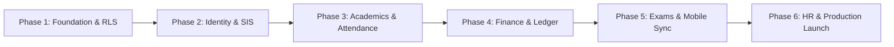

# DEVELOPMENT ROADMAP SPECIFICATION

## Fidel Hub — Phased Product Milestones

| Document Information | Details |
| :--- | :--- |
| **Document** | Development Roadmap Specification |
| **Version** | 1.0-DRAFT |

---

## Roadmap Phases

### Phase 1: Foundation, Multi-Tenancy & Scaffolding
- PostgreSQL Row-Level Security, project architecture, and brand design tokens.

### Phase 2: Identity, Tenancy & Student Information System
- Multi-tenant JWT auth, school onboarding, student registration, and guardian records.

### Phase 3: Academic Setup & Attendance Tracking
- Dual calendar (Ethiopian + Gregorian), period/daily attendance, SMS alerts.

### Phase 4: Finance & Double-Entry Ledger
- Fee schedules, invoices, payments, receipts, immutable journal vouchers.

### Phase 5: Examinations, Grading & Offline Mobile Client
- Assessments, rankings, PDF report cards, and Expo SQLite sync engine.

### Phase 6: HR, Payroll & Pilot School Deployment
- Staff contracts, payroll, load testing, and on-premises/cloud pilot deployment.
